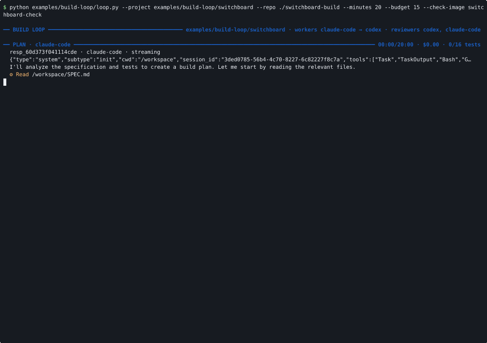
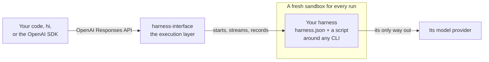

<p align="center">
  
</p>

<h1 align="center">harness-interface</h1>

<p align="center">
  <b>Run any coding harness behind one API, every run in its own sandbox.</b>
</p>

<p align="center">
  
  
  
  
  <a href="LICENSE"></a>
  <a href="https://github.com/mrcloudchase/harness-interface/actions/workflows/ci.yml"></a>
</p>

<p align="center">
  <a href="docs/users/getting-started.md">Getting started</a> ·
  <a href="docs/users/how-it-works.md">How it works</a> ·
  <a href="docs/users/README.md">Docs</a> ·
  <a href="docs/users/cli.md">CLI</a> ·
  <a href="docs/users/api.md">API</a> ·
  <a href="docs/users/library.md">Library</a> ·
  <a href="harnesses/README.md">Harnesses</a>
</p>

---

**Meet Picky**, a hermit crab with no shell of its own. Hermit crabs don't grow shells; they find
one that fits, wear it, and swap it when they need to. Picky does that with coding harnesses:
Claude Code for one task, Codex for the next, then the one you wrote yourself.

That's harness-interface:
- **One API.** Call any harness by name, through the OpenAI Responses format. Continue its
  conversation with `previous_response_id`, and get its own output streamed back.
- **One sandbox per run.** Each run is a fresh, locked-down container that can reach its model
  provider and nothing else, unless you allow more.
- **One library underneath.** Run a harness, or anything else, in that sandbox straight from
  Python.

<table align="center">
  <tr>
    <td align="center"><b>Claude Code</b><br></td>
    <td align="center"><b>Codex</b><br></td>
  </tr>
  <tr>
    <td align="center"><b>Hermes</b><br></td>
    <td align="center"><b>Pi</b><br></td>
  </tr>
</table>
<p align="center"><sub>Same command, four harnesses: each writes a haiku, then titles it in the same conversation with <code>-c</code>.</sub></p>

## Quickstart

You need git, and Docker for sandboxed runs. The installer brings everything else.

```bash
curl -fsSL https://raw.githubusercontent.com/mrcloudchase/harness-interface/main/install.sh | sh

hi server start
hi provider add anthropic --url https://api.anthropic.com --key-env ANTHROPIC_API_KEY
hi harness add --builtin claude-code
hi run claude-code "Write a haiku about a hermit crab trying on shells."
hi run claude-code "Now give it a title." -c
```

The first run builds the sandbox image, which takes a few minutes. Every run after that starts in
seconds. [Getting started](docs/users/getting-started.md) walks through it.

**It runs on your machine, for you.** The server listens on `127.0.0.1` with no authentication,
and anyone who can reach it can run harnesses with your provider keys. Don't expose it to a
network ([security](docs/users/security.md)).

## What you can do with it

**Run any harness by name.** Every harness takes the same request: `model` names it, and
`previous_response_id` continues its conversation. Ask Claude Code, then Codex, then your own
CLI, with nothing else changed.

**Build an agent on a harness.** A coding harness already does the hard part of an agent: the
tool loop, running commands, editing files, managing its context. So your agent can be a role and
a conversation, with a harness doing the work:

```python
reply = client.responses.create(model="claude-code", input="Which bread keeps longest?",
                                instructions="You are Pip, a bakery's assistant. Answer in French.",
                                previous_response_id=last)
```

Swap `claude-code` for any other harness and the agent stays the same
([an agent on a harness](docs/users/api-clients.md#an-agent-on-a-harness)).

**Engineer loops, not prompts.** Write a program that sends the task, checks the work with
something the harness can't argue with, such as tests, and sends back what failed, until it's
done. Every turn is sandboxed, costed and recorded, so a loop can run unattended.

<p align="center">
  
</p>
<p align="center"><sub><a href="examples/build-loop/">examples/build-loop</a> building a small API server from its spec and 16 acceptance tests. Claude Code builds, Codex reviews, the tests decide: 16 of 16 pass in 5 minutes. Shown at 6× speed.</sub></p>

[Run harnesses in a loop](docs/users/loops.md) has the whole run and how to write your own.

## How it works



The server owns the run: the sandbox, the conversation's workspace and session, streaming,
cancelling and the record. A harness owns everything about its CLI: it is a folder with a
`harness.json` and a script that maps the request onto the CLI's own flags. There is no new
protocol to implement, so a CLI works the way it ships, and adding one never changes the server.
[How it works](docs/users/how-it-works.md) has the details, and when it is and isn't a fit.

## Harnesses

Twenty-three ship with it, each run end to end, live, in the default sandbox: Aider,
CheetahClaws, Claude Code, Cline, Codex, DeepSeek Harness, Gajae Code, Goose, Grok CLI,
harness-engineering, Hermes, J-Code, Kilo Code, Kimi Code, MiMo Code, MiniMax Code, nanobot, OMP,
OpenCode, OpenHands, OpenSquilla, Pi and Qwen Code. [harnesses/](harnesses/README.md) has each
one's default provider and notes.

A harness's provider is a default, not a limit: Claude Code runs on DeepSeek by changing one word
([providers](docs/users/providers.md)). Your own CLI is two files away
([write a harness](docs/users/harnesses.md#write-your-own)).

## Use it from code

`hi` is one client. The API speaks the OpenAI Responses format, so the OpenAI SDK is another:

```python
from openai import OpenAI

client = OpenAI(base_url="http://127.0.0.1:8000", api_key="unused")
first = client.responses.create(model="claude-code", input="Write a haiku about a hermit crab.")
second = client.responses.create(model="claude-code", input="Now give it a title.",
                                 previous_response_id=first.id)
print(second.output_text)
```

The server is built on a Python library, and you can use it directly, with no server at all:

```python
turn = await Turn.start(runtime, Harness.from_folder(folder), provider, Request("Fix the test"),
                        workspace, folder)
async for event in turn.events():                 # its own output, as it prints it
    ...
result = await turn.result()                      # status, answer, session, cost, files changed
```

[Call the API from code](docs/users/api-clients.md) and [the Python library](docs/users/library.md)
have everything else.

## Highlights

- **Sandboxed by default.** No capabilities, a read-only root, and one way out: the provider,
  and any hosts you allow ([security](docs/users/security.md)).
- **Runs belong to the server.** They run side by side, outlive a client that disconnects, and
  can be cancelled at any point.
- **See everything.** Each harness's stdout and stderr stream live. Every run keeps its output,
  its files, its diff, its usage and cost, and the session to resume.
- **Change anything live.** Add or change a provider, sandbox or harness, and the next request
  uses it. No restarts.
- **Small enough to read.** About 1,900 lines of Python, in layers that each import only those
  below them.

## Documentation

| | |
|---|---|
| [**Using it**](docs/users/README.md) | [getting started](docs/users/getting-started.md), how it works, install, providers, harnesses, sandboxes, API clients, the library, loops, troubleshooting; the CLI, API, harness contract, configuration and security references |
| [**Contributing to it**](docs/contributors/README.md) | the architecture, development, testing, extending, conventions and releasing |

## Contributing

New harnesses are welcome: a harness is a folder in [harnesses/](harnesses/), not code.
[docs/contributors](docs/contributors/README.md) has the architecture, how it is tested, and how
a merge becomes a release.

```bash
git clone https://github.com/mrcloudchase/harness-interface && cd harness-interface
uv run --extra dev pytest          # no Docker or keys needed
```

## Status

harness-interface is the base layer: one interface to any harness, and a record of everything
each one did. Today it is single-tenant: it runs on localhost, with no authentication. Next, built
on that same record:
- comparing harnesses on the same task;
- judging their output;
- routing each request to the right one.

## License

[Apache 2.0](LICENSE).
