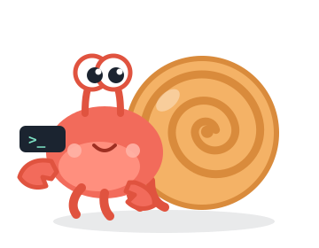

<p align="center">
  
</p>

<h1 align="center">harness-interface</h1>

<p align="center">
  <b>One API that sends a request to a harness, runs it in a sandbox, and sends the output back.</b><br>
  Providers, sandboxes and harnesses are resources you register. The server has no code for any of them.
</p>

---

A harness is any program you can start from a shell and hand a task to: Claude Code, Codex,
DeepSeek Harness, the one you wrote yourself. Each has its own flags, its own output format, its
own idea of how a key gets in and how a session is resumed. harness-interface puts one API in
front of all of them.

You register a provider, a sandbox and a harness. You send a request through the OpenAI
Responses wire format. The platform runs it on the harness, inside the sandbox, and the harness's
own output streams back over the API unchanged while the server keeps the record. Then you
continue the conversation, or start the next one.

```
PUT  /providers/deepseek    where model calls go, and the key
PUT  /sandboxes/python-dev  a Dockerfile; a locked-down `default` is built in
PUT  /harnesses/claude-code how one CLI is run and reported on; which provider, which sandbox
POST /responses             {"model": "claude-code/deepseek-chat", "input": "Fix the failing test."}
```

## Why

**One API for every harness.** The request is the Responses shape every client already speaks.
`model` names the harness. `previous_response_id` continues the conversation. What streams back
is the harness's own output, byte for byte, so nothing is lost in translation.

**Any provider, any harness, no server code.** A provider is a url and a key. The harness's own
run script decides which variables want them. Pointing Claude Code at DeepSeek is one line in a
shell script, and the server never learns what that line means.

**Every run in a sandbox.** Each response is a container built from a Dockerfile you control,
with everything dropped that Docker can drop, gVisor when the host has it, and a private
network whose only exit is a tunnel to the harness's provider. The harness can call its provider
and nothing else.

**Adding anything is a PUT.** A new harness is a folder of three files. A new provider is one line
of JSON. A new sandbox is a Dockerfile. Change any of them and the next request uses it. No
restart, ever.

**Small enough to read.** The whole server is eleven files and about 1,100 lines. The security
boundary is sixty of them.

## Try it

```bash
pip install -e .
hi serve
```

Then follow the [walkthrough](docs/walkthrough.md): add a provider, keep the default sandbox,
add Claude Code as a harness in three files, make the first request, continue it. Twenty
minutes from an empty server to a resumed conversation.

## How it fits together

```
                  ┌────────────────────────── you ──────────────────────────┐
                  │  providers          sandboxes            harnesses      │
                  │  url + key          Dockerfile + egress  scripts +      │
                  │                                          provider +     │
                  │                                          sandbox        │
                  └──────────────┬───────────────┬──────────────┬───────────┘
                                 ▼               ▼              ▼
  POST /responses ──►  harness-interface  ──►  docker run  ──►  the harness's own output, streamed
  {model, input,       builds the image,        in its sandbox,  then the record: status, answer,
   previous_response_id} wires the door,        one exit: the    usage, files, session to resume
                         keeps the record       provider host
```

The server promises every harness the same thing inside its sandbox: the task, the model, the
provider's url and key, the previous session id, and a place to write back what happened. That
contract is in [docs/reference.md](docs/reference.md), with the resource shapes, the endpoints,
and exactly what the sandbox does.

## Verified with

Claude Code on Anthropic and on DeepSeek, Codex on OpenAI, DeepSeek Harness, and a hand-written
harness from the [harness-engineering](https://github.com/averagejoeslab/harness-engineering)
course, each answering the same request through the same endpoint, three of them resuming a
conversation on a second turn.

## Docs

- [Walkthrough](docs/walkthrough.md): install, set up, first request, continue.
- [Reference](docs/reference.md): resources, the process contract, the wire format, endpoints, the sandbox, layout.

## Status

Single tenant, localhost, no authentication. It is the base layer: an interface to harnesses and
a record of everything they did. Comparing harnesses on the same task, judging their output, and
routing by their record are the layers that come next, and all of them sit on this record without
changing it.
