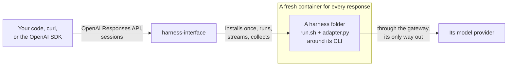

<p align="center">
  
</p>

<h1 align="center">harness-interface</h1>

<p align="center">
  <b>Run any coding harness as a sandboxed session behind one API.</b>
</p>

<p align="center">
  
  
  
  <a href="LICENSE"></a>
  <a href="https://github.com/mrcloudchase/harness-interface/actions/workflows/ci.yml"></a>
</p>

<p align="center">
  <a href="docs/users/getting-started.md">Getting started</a> ·
  <a href="docs/users/how-it-works.md">How it works</a> ·
  <a href="docs/users/README.md">Docs</a> ·
  <a href="docs/users/api.md">API</a> ·
  <a href="docs/users/library.md">Library</a> ·
  <a href="harnesses/README.md">Harnesses</a>
</p>

---

**Meet Picky**, a hermit crab with no shell of its own. Hermit crabs don't grow shells; they find one
that fits, wear it, and swap it when they need to. Picky does that with coding harnesses: Claude Code
for one task, Codex for the next, then the one you configured yourself.

That's harness-interface, an execution layer for coding CLIs:
- **One API.** Call any harness by name through the OpenAI Responses format. Continue its session,
  steer it while it works, stop it, and get its own output streamed back.
- **One sandbox per response.** A fresh, locked-down container that reaches its model provider and
  nothing else, holding a session token instead of your key.
- **Harnesses are folders.** How to install a CLI, which config and work artifacts it brings, how to
  run, steer and stop it, and what to report back: all in its folder. The server has no code for any.

## Quickstart

You need git and Docker. The installer brings everything else.

```bash
curl -fsSL https://raw.githubusercontent.com/mrcloudchase/harness-interface/main/install.sh | sh
harness-interface
```

Then add a provider, register a harness folder and run it:
[getting started](docs/users/getting-started.md) takes about ten minutes.

```bash
curl -s localhost:8000/responses -H 'content-type: application/json' \
  -d '{"model": "claude-code", "input": "Write hello.py and run it.", "instructions": "Be brief."}'
```

**It runs on your machine, for you.** The server listens on `127.0.0.1` with no authentication, and
anyone who can reach it can run harnesses with your provider keys. Don't expose it to a network
([security](docs/users/security.md)).

## What a response gives back

Everything, streamed as it happens and whole at the end: the answer, the CLI's own stdout and stderr,
the workspace's diff and every changed file, the files its folder reports from `$HOME` (memory it
wrote, its transcript), its usage and cost, and its resume handle.

```python
from openai import OpenAI

client = OpenAI(base_url="http://127.0.0.1:8000", api_key="unused")   # the server holds the keys
first = client.responses.create(model="claude-code", input="Remember the word ORCHID. Reply OK.")
second = client.responses.create(model="claude-code", input="Which word did I ask you to remember?",
                                 previous_response_id=first.id)   # the same session: ORCHID
print(second.model_extra["harness"]["usage"], second.model_extra["harness"]["changes"])
```

A session stays on its harness and provider, keeps its workspace and the CLI's own `.home/`, and runs
one response at a time. While one runs, `POST /sessions/{id}/interrupt` steers more text into it, and
`POST /sessions/{id}/stop` stops it gracefully. [Calling the API](docs/users/api-clients.md) has the
rest.

## How it works



A harness's CLI is installed once per version into a cached tools directory, on a small base image
with no CLI and no secret. Each response copies the folder's config artifacts (`home/`) into the
session's `$HOME`, writes the request's files into its workspace, and runs the folder's `run.sh` with
the request on stdin. The contract is environment variables, stdin and one result file
([harness contract](docs/users/harness-contract.md)), so any CLI fits, and adding one never changes the
server. [How it works](docs/users/how-it-works.md) has the details.

## Harnesses

Five ship with it, each proven live, sandboxed, from the library and the API: **Claude Code**,
**Codex**, **pi**, **OpenCode** and **Hermes**, plus a template. All five can be steered while they
work, stopped gracefully and resumed. [harnesses/](harnesses/README.md) has each one's provider and how
it is driven, and a survey of eighteen more.

A harness's provider is a default, not a limit: `claude-code@deepseek/deepseek-chat` runs Claude Code
on DeepSeek ([providers](docs/users/providers.md)). Configure one your way by copying its folder and
putting your skills, MCP servers, hooks and instructions in its `home/`
([harness folders](docs/users/harnesses.md)).

## Use it from Python

The server is built on a library you can use directly, with no server:

```python
sessions = Sessions(data, Placement(Images(data / "logs"), owner=owner_of(data)))
session = await sessions.start(Ask("claude-code", "Fix the failing test."))
async for event in sessions.follow(session.id):       # its own output, as it prints it
    ...
record = await sessions.wait(session.responses[-1])   # status, answer, usage, cost, resume
```

[The Python library](docs/users/library.md) has the whole example.

## Highlights

- **Sandboxed by default.** No capabilities, a read-only root, an unprivileged user, and one way out:
  the provider through its gateway ([security](docs/users/security.md)).
- **The key never enters the sandbox.** The gateway swaps the session's token for it.
- **Sessions belong to the server.** They run side by side, outlive a client that disconnects, and can
  be followed by any number of clients.
- **Change anything live.** Add or replace a provider or harness folder, and the next request uses it.
- **Small enough to read.** About 3,500 lines of Python, standard library only below the HTTP layer,
  in layers that each import only those below them.

## Documentation

| | |
|---|---|
| [**Using it**](docs/users/README.md) | getting started, how it works, install, providers, harness folders, API clients, the library, troubleshooting; the API, contract, configuration and security references |
| [**Contributing to it**](docs/contributors/README.md) | the architecture, development, testing, extending, conventions and releasing |

## Contributing

New harnesses are welcome: a harness is a folder in [harnesses/](harnesses/), not code.

```bash
git clone https://github.com/mrcloudchase/harness-interface && cd harness-interface
uv run --extra dev pytest          # no Docker or keys needed
```

## License

[Apache 2.0](LICENSE).
