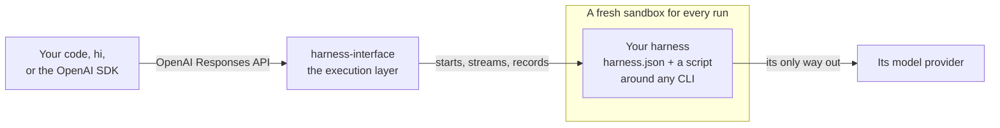

<p align="center">
  
</p>

<h1 align="center">harness-interface</h1>

<p align="center">
  <b>Run any coding harness behind one API, every run in its own sandbox.</b>
</p>

<p align="center">
  
  
  
  
  <a href="LICENSE"></a>
  <a href="https://github.com/mrcloudchase/harness-interface/actions/workflows/ci.yml"></a>
</p>

<p align="center">
  <a href="docs/users/getting-started.md">Getting started</a> ·
  <a href="docs/users/README.md">Docs</a> ·
  <a href="docs/users/cli.md">CLI</a> ·
  <a href="docs/users/api.md">API</a> ·
  <a href="docs/users/library.md">Library</a> ·
  <a href="harnesses/README.md">Harnesses</a>
</p>

---

**Meet Picky**, a hermit crab with no shell of its own. Hermit crabs don't grow shells; they find
one that fits, wear it, and swap it when they need to. Picky does that with coding harnesses:
Claude Code for one task, Codex for the next, then the one you wrote yourself.

That's harness-interface:
- **One API.** Call any harness by name, through the OpenAI Responses format. Continue its
  conversation with `previous_response_id`, and get its own output streamed back.
- **One sandbox per run.** Each run is a fresh, locked-down container that can reach its model
  provider and nothing else.
- **One library underneath.** Run a harness, or anything else, in that sandbox straight from
  Python.

<table align="center">
  <tr>
    <td align="center"><b>Claude Code</b><br></td>
    <td align="center"><b>Codex</b><br></td>
  </tr>
  <tr>
    <td align="center"><b>Hermes</b><br></td>
    <td align="center"><b>Pi</b><br></td>
  </tr>
</table>
<p align="center"><sub>Same command, four harnesses: each writes a haiku, then titles it in the same conversation with <code>-c</code>.</sub></p>

## Quickstart

You need git, and Docker for sandboxed runs. The installer brings everything else.

```bash
curl -fsSL https://raw.githubusercontent.com/mrcloudchase/harness-interface/main/install.sh | sh

hi server start
hi provider add anthropic --url https://api.anthropic.com --key-env ANTHROPIC_API_KEY
hi harness add --builtin claude-code
hi run claude-code "Write a haiku about a hermit crab trying on shells."
hi run claude-code "Now give it a title." -c
```

The first run builds the sandbox image, which takes a few minutes. Every run after that starts in
seconds. [Getting started](docs/users/getting-started.md) walks through it.

**It runs on your machine, for you.** The server listens on `127.0.0.1` with no authentication,
and anyone who can reach it can run harnesses with your provider keys. Don't expose it to a
network ([security](docs/users/security.md)).

## How it works



The server is the execution layer, and a harness is configuration:
- **The server owns the run:** the sandbox, the conversation's workspace and session, streaming,
  cancelling, timeouts, and the record of what happened.
- **A harness owns everything about its CLI.** It is a folder: a `harness.json`, and a script
  that turns the request into the CLI's own flags. It decides where instructions go, how a
  session resumes, which API the CLI speaks, and how its output becomes an answer.

### No new harness protocol

Clients use the OpenAI Responses API they already know. Inside, a harness is any program that
reads a few environment variables (`HI_TASK`, `HI_PROVIDER_KEY` and the rest) and may write one
JSON file back. That is the whole [harness contract](docs/users/harness-contract.md). No
harness has to implement a shared protocol, so a CLI works the way it ships, and adding one never
changes the server.

The trade-off: the server doesn't translate harnesses into a common vocabulary. Every run gets
the same record (the answer, usage, cost, the files it changed and their diff) beside the
harness's own output, byte for byte. There is no shared event schema, and no capability
discovery across harnesses.

### When to use it

A good fit for:
- running harnesses from your own code or loops, on a machine you control;
- wrapping your own CLI, or one nobody else supports, without changing the server;
- running the same task on several harnesses, each sandboxed and recorded.

Not a fit, today, for:
- a hosted service for many users: there is no authentication or tenancy;
- fast, high-volume decisions such as classifying or routing: every run starts a container and
  a workspace, which costs seconds, not milliseconds.

## Supported harnesses

Every harness here ships with harness-interface, and has been run end to end in the default
sandbox: a first request, then a continued second one that kept the request's instructions.
`hi harness add --builtin` registers them. [How they are verified](docs/contributors/testing.md#live-checks)
has the details.

| Harness | Default provider | Runs | Continues |
|---|---|:-:|:-:|
| [Aider](harnesses/aider) | `anthropic` | ✅ | ✅ |
| [CheetahClaws](harnesses/cheetahclaws) | `openai` | ✅ | ✅ |
| [Claude Code](harnesses/claude-code) | `anthropic` | ✅ | ✅ |
| [Cline](harnesses/cline) | `anthropic` | ✅ | ✅ |
| [Codex](harnesses/codex) | `openai` | ✅ | ✅ |
| [DeepSeek Harness](harnesses/deepseek-harness) | `deepseek` | ✅ | ✅ |
| [Gajae Code](harnesses/gajae) | `anthropic` | ✅ | ✅ |
| [Goose](harnesses/goose) | `anthropic` | ✅ | ✅ |
| [Grok CLI](harnesses/grok-cli) | `deepseek-openai` | ✅ | ✅ |
| [harness-engineering](harnesses/harness-engineering) | `anthropic` | ✅ | ✅ |
| [Hermes](harnesses/hermes) | `anthropic` | ✅ | ✅ |
| [J-Code](harnesses/jcode) | `anthropic` | ✅ | ✅ |
| [Kilo Code](harnesses/kilo) | `anthropic` | ✅ | ✅ |
| [Kimi Code](harnesses/kimi-code) | `deepseek` | ✅ | ✅ |
| [MiMo Code](harnesses/mimo) | `anthropic` | ✅ | ✅ |
| [MiniMax Code](harnesses/minimax-code) | `deepseek` | ✅ | ✅ |
| [nanobot](harnesses/nanobot) | `anthropic` | ✅ | ✅ |
| [OMP](harnesses/omp) | `anthropic` | ✅ | ✅ |
| [OpenCode](harnesses/opencode) | `anthropic` | ✅ | ✅ |
| [OpenHands](harnesses/openhands) | `anthropic` | ✅ | ✅ |
| [OpenSquilla](harnesses/opensquilla) | `anthropic` | ✅ | ✅ |
| [Pi](harnesses/pi) | `anthropic` | ✅ | ✅ |
| [Qwen Code](harnesses/qwen-code) | `deepseek-openai` | ✅ | ✅ |

The provider is a default, not a limit. Any provider that speaks the API a CLI expects works:
Claude Code runs on DeepSeek by changing one word ([providers](docs/users/providers.md)). Your
own CLI is two files away ([write a harness](docs/users/harnesses.md#write-your-own)).

## Highlights

- **Any harness, one request shape.** `model` names the harness, `previous_response_id`
  continues it, and its own output streams back line for line.
- **Sandboxed by default.** No capabilities, a read-only root, and one network exit: the
  provider ([security](docs/users/security.md)).
- **Built for many clients.** Runs belong to the server: they run side by side, survive a client
  disconnecting, and can be cancelled at any point.
- **Everything recorded.** Each run keeps:
  - the harness's raw output and log;
  - its produced files;
  - its usage and cost;
  - the session to resume.
- **Build an agent, not a harness.** Give a harness a role and keep the conversation; the
  harness behind it is one name you can swap ([below](#build-an-agent-not-a-harness)).
- **Built for loops.** Drive harnesses from a program, not by hand
  ([below](#loop-engineering-made-easier)).
- **See everything.** Each harness's stdout and stderr stream live. Every file it adds, changes
  or deletes is recorded, and each turn's diff can be read, even while it's running.
- **Change anything live.** Add or change a provider, sandbox or harness, and the next request
  uses it. No restarts.
- **A library first.** Everything the server does, Python can do directly, with no server and
  nothing beyond the standard library ([below](#use-it-from-python)).
- **Small enough to read.** About 1,900 lines of Python, in layers that each import only those
  below them. The sandbox and its egress door are about 300 of them.

## Build an agent, not a harness

A coding harness already does the hard part of an agent: the tool loop, running commands,
editing files, managing its context, resuming its sessions. Building and maintaining one is a job
of its own. Here you skip it. Your agent is a role and a conversation, and a harness you pick does
the work behind it:

```python
from openai import OpenAI

client = OpenAI(base_url="http://127.0.0.1:8000", api_key="unused")


class Pip:
    """A bakery's assistant. The harness behind it is one name: swap it for any other."""
    harness = "claude-code"
    role = "You are Pip, a bakery's assistant. Answer in French, in one sentence, and sign with -- Pip."

    def __init__(self):
        self.last = None                                  # the conversation so far

    def ask(self, text: str) -> str:
        reply = client.responses.create(model=self.harness, instructions=self.role, input=text,
                                        previous_response_id=self.last)
        self.last = reply.id
        return reply.output_text


pip = Pip()
pip.ask("Which bread keeps longest, and why?")   # "Le pain de seigle se conserve le plus longtemps … -- Pip"
pip.ask("And which one did you just name?")      # "Je viens de nommer le pain de seigle. -- Pip"
```

- **Swap the harness, keep the agent.** Set `harness = "codex"`, or any of the 23, or one you
  wrote, and nothing else changes. Every shipped harness hands the role to its CLI, most as
  `AGENTS.md`.
- **It works in a sandbox.** Whatever the harness does for your agent, it does in a container
  that can reach only its provider.
- **Its work is on the record.** Every turn's answer, changed files, diff, cost and output can be
  read back.

## Loop engineering, made easier

Stop prompting your harness; write a loop around it. The loop sends the task, checks the work
with something the harness can't argue with, such as tests, and sends back what failed, until
it's done. Everything a loop needs is built in, the same for every harness:

| A loop needs to | harness-interface gives it |
|---|---|
| run any harness the same way | one request shape: `model` names the harness |
| send the failures back | `previous_response_id`, which resumes the harness's own session |
| check the work from outside | each turn's `/diff` and `/files`, even while it runs |
| stop at a deadline or a budget | `POST /responses/{id}/cancel`, and the cost each harness reports |
| run unattended | every turn in a sandbox that reaches only its provider |
| show what happened | each harness's stdout and stderr, streamed live and kept |

<p align="center">
  
</p>
<p align="center"><sub><a href="examples/build-loop/">examples/build-loop</a> building a small API server from its spec and 16 acceptance tests. Claude Code builds, Codex reviews, the tests decide: 16 of 16 pass in 5 minutes. Shown at 6× speed.</sub></p>

The loop is one Python file. It plans, builds, verifies in a container, has a second harness
review each change, and checkpoints in git. It escalates a stuck task to another harness, and
stops cleanly at its deadline or budget. [Run harnesses in a loop](docs/users/loops.md) has the
whole run and how to write your own.

## Use it from code

`hi` is one client. The API speaks the OpenAI Responses format, so the OpenAI SDK is another:

```python
from openai import OpenAI

client = OpenAI(base_url="http://127.0.0.1:8000", api_key="unused")
first = client.responses.create(model="claude-code", input="Write a haiku about a hermit crab.")
second = client.responses.create(model="claude-code", input="Now give it a title.",
                                 previous_response_id=first.id)
print(second.output_text)
```

curl, streaming and everything else: [Call the API from code](docs/users/api-clients.md).

## Use it from Python

The server is built on a library you can use directly. Run a harness folder in its sandbox, with
no server and no HTTP:

```python
import os
from pathlib import Path

from harness_interface import Docker, DockerRuntime, Harness, Provider, Request, Turn
from harness_interface.resources import DEFAULT_SANDBOX

# in async code
folder = Path("harnesses/claude-code").resolve()
provider = Provider("anthropic", "https://api.anthropic.com", os.environ["ANTHROPIC_API_KEY"])
runtime = DockerRuntime(Docker(Path("logs")), DEFAULT_SANDBOX, egress=[provider.host], mounts=[folder])

turn = await Turn.start(runtime, Harness.from_folder(folder), provider,
                        Request("Write a haiku about a hermit crab."), Path("work").resolve(), folder)
async for event in turn.events():                 # its own output, as it prints it
    print(event.data.decode(), end="")
result = await turn.result()                      # status, answer, session, cost, files changed
```

Swap `DockerRuntime` for `LocalRuntime()` to run on your machine, or give the runtime any command
as a `Spec`. [The Python library](docs/users/library.md) has it all.

## Documentation

| | |
|---|---|
| [**Using it**](docs/users/README.md) | [getting started](docs/users/getting-started.md), install, providers, harnesses, sandboxes, API clients, the library, loops, troubleshooting; the CLI, API, harness contract, configuration and security references |
| [**Contributing to it**](docs/contributors/README.md) | the architecture, development, testing, extending, conventions and releasing |

## Contributing

```bash
git clone https://github.com/mrcloudchase/harness-interface && cd harness-interface
uv run --extra dev pytest          # no Docker or keys needed
uv run --extra server harness-interface   # the server, from source
```

New harnesses are welcome: a harness is a folder in [harnesses/](harnesses/), not code.
[docs/contributors](docs/contributors/README.md) has the architecture, how it is tested, and how
a merge becomes a release.

## Status

harness-interface is the base layer: one interface to any harness, and a record of everything
each one did. Today it is single-tenant: it runs on localhost, with no authentication. Next, built
on that same record:
- comparing harnesses on the same task;
- judging their output;
- routing each request to the right one.

## License

[Apache 2.0](LICENSE).
