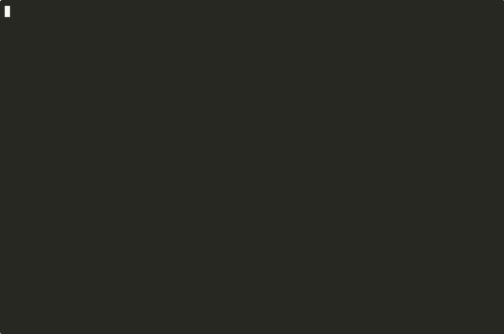

<p align="center">
  
</p>

<h1 align="center">Harness Gateway</h1>

<p align="center">
  <b>Run any coding-agent CLI, sandboxed, behind the OpenAI Responses API.</b>
</p>

<p align="center">
  <a href="https://github.com/mrcloudchase/harnessgatewayai/actions/workflows/ci.yml"></a>
  <a href="https://github.com/mrcloudchase/harnessgatewayai/releases"></a>
  
  
  <a href="LICENSE"></a>
</p>

Every coding agent is a CLI with its own flags, its own config directory and its own idea of
where the API key goes. Teams that want to use several of them end up with keys scattered across
agent environments, no shared record of what the agents did, and a new integration for each one.

Harness Gateway is the execution layer that fixes that. A tenant brings its **providers** (model
endpoints and keys, sealed on arrival) and its **harness packages** (how to install a CLI, how to
run one turn, what to return). Members send `POST /v1/responses` with `model` naming a harness.
The platform runs the package in a fresh sandbox it owns, relays the CLI's provider calls
through a gateway that holds the keys, streams the output back, keeps the complete record, and
returns exactly what the package decided. Any OpenAI SDK works unchanged.

```
                 OpenAI Responses API (any SDK, curl, the app)
                                  │
    api  ─── records (SQLite | Postgres) ─── blobs (directory | S3)
    gateway  holds the provider keys, relays provider calls, meters, captures
    worker   joins with a token, pulls turns, runs each in a fresh sandbox
                                  │
         sandbox: the package's CLI, a door as its only way out, a token instead of a key
```

## Run it

You need Docker: a Linux machine, or Docker Desktop on a Mac. No cloud account.

```bash
mkdir -p /srv/hg/data
docker run -d --name hg --restart unless-stopped -p 127.0.0.1:8000:8000 -p 127.0.0.1:8081:8081 \
  -v /var/run/docker.sock:/var/run/docker.sock -v /srv/hg/data:/srv/hg/data -e HG_DATA_DIR=/srv/hg/data \
  --add-host host.docker.internal:host-gateway ghcr.io/mrcloudchase/harnessgateway:5.0.0
docker exec hg harnessgateway init --tenant acme --owner chase     # prints the deployer key and your key, once
```

Then, with your key as `$KEY`, add a provider, fork a package from the catalog and send a request:

```bash
HG=http://127.0.0.1:8000
curl -s -X PUT $HG/v1/providers/deepseek -H "Authorization: Bearer $KEY" -H 'content-type: application/json' \
  -d "{\"url\": \"https://api.deepseek.com/anthropic\", \"api\": \"anthropic-messages\", \"key\": \"$DEEPSEEK_API_KEY\"}"
curl -s -X PUT $HG/v1/harnesses/claude-code -H "Authorization: Bearer $KEY" -H 'content-type: application/json' \
  -d '{"catalog": "claude-code"}'
curl -s $HG/v1/responses -H "Authorization: Bearer $KEY" -H 'content-type: application/json' \
  -d '{"model": "claude-code", "input": "Create hello.txt containing the word hello, then reply with the one word: done"}'
```

The same three steps are in the app at `http://127.0.0.1:8000/app`. The documentation is at
`/docs`. The first request to a package installs its CLI once, which takes a minute or two.

## From the OpenAI SDK

```python
from openai import OpenAI

client = OpenAI(api_key="hg_…", base_url="http://127.0.0.1:8000/v1")
r = client.responses.create(model="claude-code", input="Add a test for the parser and run it.")
print(r.status, r.output_text)

r2 = client.responses.create(model="claude-code", input="Now fix what failed.", previous_response_id=r.id)
```

`model` names a harness, or `harness/provider/model` to choose all three. `previous_response_id`
continues the session in the same workspace. `stream=True` relays the agent's output as it is
written. Steering a running turn, the trace, the provider captures and the workspace archive are
plain routes under the same key. [Clients](docs/clients.md) has the rest.

## Watch it

<p align="center">
  
</p>

Claude Code taking a streamed turn and a steer, recorded as it ran. [Six harnesses](docs/demos.md)
are recorded the same way.

## The catalog

Twenty-two packages ship with the platform. Each was run through nine live checks against a real
provider: make a file and say done, recall it on the next turn, the archive holds it, a turn
streams, a steer is accepted and answered, a running turn cancels, the trace records all of it,
and a stateless request leaves nothing behind.

| Package | Checks | | Package | Checks |
|---|---|---|---|---|
| [Claude Code](docs/catalog/claude-code.md) | 9/9 | | [Kimi Code](docs/catalog/kimi-code.md) | 9/9 |
| [Codex](docs/catalog/codex.md) | 9/9 | | [MiMo Code](docs/catalog/mimo.md) | 9/9 |
| [OpenCode](docs/catalog/opencode.md) | 9/9 | | [MiniMax Code](docs/catalog/minimax-code.md) | 9/9 |
| [Hermes Agent](docs/catalog/hermes.md) | 9/9 | | [nanobot](docs/catalog/nanobot.md) | 9/9 |
| [pi](docs/catalog/pi.md) | 9/9 | | [Oh My Pi](docs/catalog/omp.md) | 9/9 |
| [Cline](docs/catalog/cline.md) | 9/9 | | [Qwen Code](docs/catalog/qwen-code.md) | 9/9 |
| [goose](docs/catalog/goose.md) | 9/9 | | [CheetahClaws](docs/catalog/cheetahclaws.md) | 9/9 |
| [OpenHands](docs/catalog/openhands.md) | 9/9 | | [jcode](docs/catalog/jcode.md) | 9/9 |
| [DeepSeek Harness](docs/catalog/dsh.md) | 9/9 | | [OpenSquilla](docs/catalog/opensquilla.md) | 8/9 |
| [Grok Build](docs/catalog/grok.md) | 9/9 | | [zeroclaw](docs/catalog/zeroclaw.md) | 7/9 |
| [Kilo CLI](docs/catalog/kilo.md) | 9/9 | | [aider](docs/catalog/aider.md) | 6/9 |

Fork one as it is, or fork it and change what it returns. Your own CLI is a folder with three
scripts: [write a package](docs/packages.md). The CLIs are their authors' projects; a package is
only how this platform runs one.

## What a sandbox promises

- A provider's key is in the clear only inside the gateway, for one upstream call at a time. The
  sandbox gets a per-turn token and a URL; it never sees the key.
- A fresh container per turn: no capabilities, no privilege escalation, a read-only root, the
  tenant's own uid, and the tenant's cpu, memory and pid ceilings. gVisor underneath with one
  variable.
- One route out: a door that tunnels only to the hosts the package names, refuses private
  addresses after resolution, and forwards provider calls to the gateway.
- Every write the platform makes into a sandbox's trees refuses symlinks at every step.

Each promise has a test behind it: [security](docs/security.md).

## Documentation

Served by the platform at `/docs`, written from the code, in the order you meet it.

| | Start here |
|---|---|
| Run it | [Deploy](docs/deploy.md), [Initialize](docs/initialize.md), [The app](docs/app.md) |
| Use it | [Providers](docs/providers.md), [Harnesses](docs/harnesses.md), [First request](docs/first-request.md), [Sessions](docs/sessions.md), [Steer and cancel](docs/steer-and-cancel.md), [Traces and captures](docs/traces-and-captures.md), [Clients](docs/clients.md) |
| Operate it | [Tenants and limits](docs/tenants.md), [Workers and scale](docs/workers.md), [Configuration](docs/configuration.md), [Security](docs/security.md), [Troubleshooting](docs/troubleshooting.md) |
| Build on it | [Write a package](docs/packages.md), [The catalog](docs/catalog/index.md), [API](docs/api.md), [Architecture](docs/architecture.md) |

## Hosted or yours

The same image is harnessgateway.ai and your own box. One image, four roles (`api`, `gateway`,
`worker`, `all`), one compose file with a one-box profile and a fleet profile. Records in SQLite
or Postgres, blobs in a directory or any S3-API store, and no cloud SDK anywhere else.
`HG_SIGNUP=open` lets anyone create a tenant; closed, the deployer creates tenants and sets their
ceilings.

## Contributing and security

Pull requests against `main`; CI runs the suite on both backends, the Docker tests, the layer
rule, lint and a strict build of the docs. [Contributing](docs/contributing.md) has the setup and
the conventions. Report a vulnerability through a private security advisory on this repository,
not an issue.

## License

Apache 2.0.
