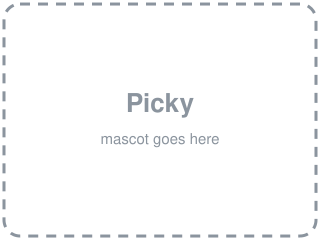
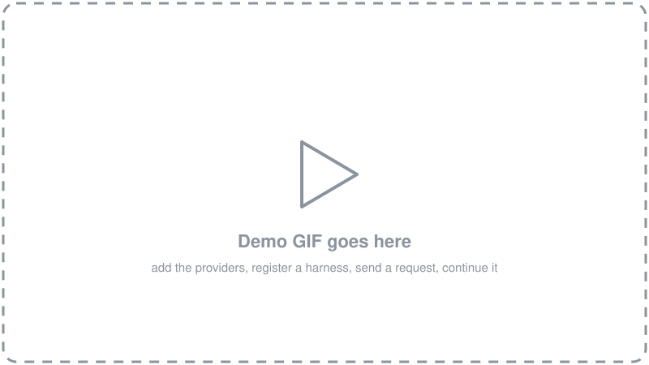

<p align="center">
  <!-- Mascot placeholder: replace docs/media/mascot.svg with the final image of Picky. -->
  
</p>

<h1 align="center">harness-interface</h1>

<p align="center">
  <b>One API in front of every harness. Send a request, it runs in a sandbox, the output comes back.</b><br>
  Providers, sandboxes and harnesses are resources you add over the API. The server has no code for any of them.
</p>

<p align="center">
  <!-- Demo placeholder: replace docs/media/demo.svg with docs/media/demo.gif. -->
  
</p>

---

A harness is any program you can start from a shell and hand a task to: Claude Code, Codex,
Gemini CLI, OpenCode, Aider, the one you wrote yourself. Each has its own flags, its own output
format, its own way of taking a key and of resuming a session. harness-interface puts one API in
front of all of them.

You add a provider, pick a sandbox and add a harness. You send a request in the OpenAI Responses
wire format, with the harness's name as the `model`. The server runs the harness inside the
sandbox, streams the harness's own output back unchanged, and keeps a record of the run. Send
`previous_response_id` and the same harness picks the conversation up where it left off.

```
PUT  /providers/anthropic    a url and a key
PUT  /sandboxes/python-dev   a Dockerfile; a locked-down `default` is built in
PUT  /harnesses/claude-code  how one CLI is run; which provider, which sandbox
POST /responses              {"model": "claude-code", "input": "Fix the failing test."}
POST /responses              {"model": "claude-code", "input": "Now add a test for it.", "previous_response_id": "resp_…"}
```

## Why

**One request shape for every harness.** The request is the Responses shape clients already
speak. `model` names the harness, or `harness/model` to pick its model too.
`previous_response_id` continues the conversation. What streams back is the harness's own output,
line for line, so nothing is lost in translation.

**Any provider on any harness, with no server code.** A provider is a url and a key. Each
harness's run script decides which of the CLI's variables get them. Pointing Claude Code at
DeepSeek means changing one word in its `harness.json`. The server never learns what that word means.

**Every run in a sandbox.** Each response runs in a fresh container. All capabilities are
dropped and the root filesystem is read-only. Its private network has exactly one way out: a
tunnel to the harness's provider. The harness can call its model and nothing else, and it cannot
use the tunnel for anything else either.

**Adding anything is a PUT.** A provider is three fields. A sandbox is a Dockerfile. A harness is
a folder of small files. Change any of them and the next request uses the change, with no restart.

**Twenty-five harnesses ship ready.** [harnesses/](harnesses/) holds 25 harnesses, each a folder,
registered with one loop. The built-in sandbox already has every one of their CLIs. Every one is
tested on a first turn and on a resumed second turn.

**Small enough to read.** The whole server is eleven Python modules and about 1,100 lines.

## Try it

You need Python 3.11+, [uv](https://docs.astral.sh/uv/), git and Docker.

```bash
git clone https://github.com/mrcloudchase/harness-interface && cd harness-interface
uv run harness-interface          # http://127.0.0.1:8000; state under ./data
```

`uv run` creates the virtual environment, installs the locked dependencies and starts the server.
Then follow the [walkthrough](docs/walkthrough.md): add a provider, register Claude Code, make the
first request, continue it. Every step is an HTTP call.

## How it fits together

```
           you add, over the API, at any time
  ┌──────────────┬────────────────────────┬───────────────────────────────┐
  │ providers    │ sandboxes              │ harnesses                     │
  │ url + key    │ Dockerfile + egress    │ scripts + run config          │
  │              │ (`default` built in)   │ + a provider + a sandbox      │
  └──────┬───────┴───────────┬────────────┴───────────────┬───────────────┘
         ▼                   ▼                            ▼
POST /responses ─► harness-interface ─► its own network ─► the harness's output, streamed,
{model, input,     builds the image     one container      then the record: status, answer,
 previous_         once, opens the      for the harness,   usage, cost, files, the session
 response_id}      egress door          one door out       to resume
```

The server promises every harness the same things inside its sandbox: the task, the model, the
provider's url and key, the session to resume, and a file to write back what happened. The
contract, the resource shapes, every endpoint and exactly what the sandbox enforces are in
[docs/reference.md](docs/reference.md).

## Verified

All 25 shipped harnesses were added through the API to a running server and run in the default
sandbox image on Docker. Each one answered a first request, and each one continued the
conversation on a second request with `previous_response_id`. Gemini CLI and Qoder need keys
that were not available, so they were not run. Inside a live run, the sandbox reached its
provider and nothing else. The details are in [docs/reference.md](docs/reference.md#verified).

## Docs

- [Walkthrough](docs/walkthrough.md): install, add a provider, register a harness, first request, continue.
- [Reference](docs/reference.md): resources, the process contract, the wire format, endpoints, a request end to end, the sandbox, configuration, layout.
- [Harnesses](harnesses/README.md): the 25 that ship, registering them, and what each one needs.

## Status

Single tenant, localhost, no authentication. This is the base layer: one interface to any
harness, and a record of everything each one did. Comparing harnesses on the same task, judging
their output and routing between them are the layers that come next. All of them build on this
record without changing it.
