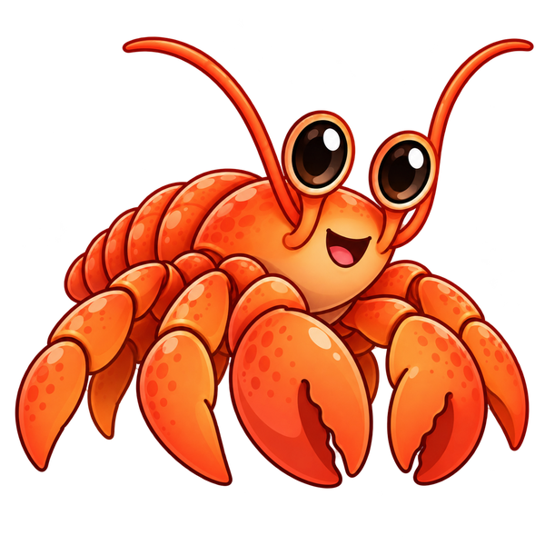
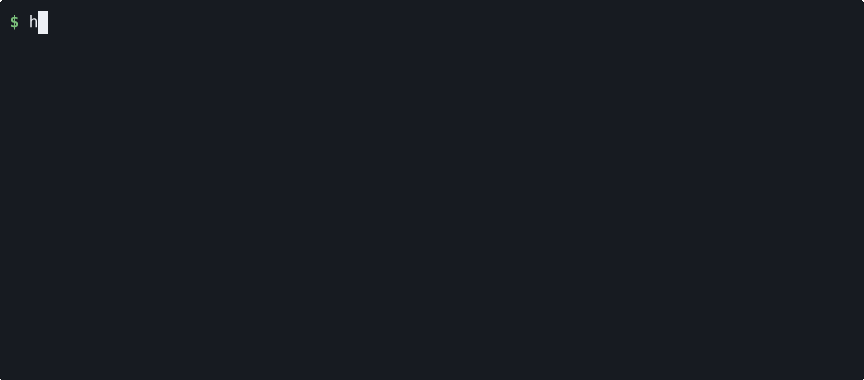

<p align="center">
  
</p>

<h1 align="center">harness-interface</h1>

<p align="center">
  <b>Run any coding harness behind one API, every run in its own sandbox.</b><br>
  Claude Code, Codex, Hermes, Pi and 19 more, called by name through the OpenAI Responses wire format.
</p>

<p align="center">
  
  
  
  
</p>

<p align="center">
  <a href="docs/setup.md">Setup</a> ·
  <a href="docs/walkthrough.md">Walkthrough</a> ·
  <a href="docs/cli.md">CLI</a> ·
  <a href="docs/api.md">API</a> ·
  <a href="docs/architecture.md">Architecture</a> ·
  <a href="harnesses/README.md">Harnesses</a>
</p>

<table align="center">
  <tr>
    <td align="center"><b>Claude Code</b><br></td>
    <td align="center"><b>Codex</b><br></td>
  </tr>
  <tr>
    <td align="center"><b>Hermes</b><br></td>
    <td align="center"><b>Pi</b><br></td>
  </tr>
</table>
<p align="center"><sub>One command, four harnesses. Each writes a haiku, then titles it in the same conversation with <code>-c</code>.</sub></p>

---

Every coding harness has its own flags, its own output format, its own way of taking a key, and
its own idea of how a session resumes. **harness-interface puts one API in front of all of
them:**
- You send a request with the harness's name as the `model`.
- It runs inside a locked-down container whose only way out is the model provider.
- The harness's own output streams back.
- Send `previous_response_id`, and the same harness picks the conversation up where it left off.

The server has no code for any harness. Providers, sandboxes and harnesses are resources you add
over the API, and each harness is a small folder you can read in a minute and change in two.

## Quickstart

You need git, and Docker for sandboxed runs. The installer brings everything else.

```bash
curl -fsSL https://raw.githubusercontent.com/mrcloudchase/harness-interface/main/install.sh | sh

hi server start
hi provider add anthropic --url https://api.anthropic.com --key-env ANTHROPIC_API_KEY
hi harness add --builtin claude-code
hi run claude-code "What is 17 * 23?"
hi run claude-code "And what is that times 2?" -c
```

The first run builds the sandbox image, which takes a few minutes; after that, each run starts in
seconds. [Setup](docs/setup.md) has the details, and the [walkthrough](docs/walkthrough.md) goes
from here to writing your own harness.

## Why harness-interface

**One request shape for every harness.** Requests use the OpenAI Responses wire format that
clients already speak:
- `model` names the harness, or `harness/model` to pick its model too;
- `previous_response_id` continues the conversation;
- what streams back is the harness's own output, line for line, so nothing is lost in
  translation.

**Any provider, any harness, no server code.** A provider is a url and a key. Each harness's run
script maps them onto its CLI's own settings. Running Claude Code on DeepSeek instead of
Anthropic means changing one word in its `harness.json`.

**Sandboxed by default.** Every run is a fresh container:
- every capability dropped, and a read-only root;
- a private network with exactly one exit: a tunnel to the harness's model provider.

The harness can call its model and nothing else.

**Built for many clients.** Runs belong to the server, not to the connection that started them:
- many run side by side;
- a client can disconnect and the run still finishes and is recorded;
- any run can be cancelled at any point.

**Everything is recorded.** Each response keeps:
- the harness's raw output and log;
- the files it produced;
- its usage and cost;
- the session to resume.

All of it is readable over the API.

**Changes without restarts.** Add or change a provider, sandbox or harness, and the next request
uses it.

**Small enough to read.** The server is about 1,200 lines of Python. The sandbox and its egress
door, the whole security boundary, are about 250 of them.

## 23 harnesses, ready to run

Each one is tested on a first request and on a resumed second one. `hi harness add --builtin`
registers them all, and the built-in sandbox already has every CLI installed.

| | | | |
|---|---|---|---|
| [Aider](harnesses/aider) | [CheetahClaws](harnesses/cheetahclaws) | [Claude Code](harnesses/claude-code) | [Cline](harnesses/cline) |
| [Codex](harnesses/codex) | [DeepSeek Harness](harnesses/deepseek-harness) | [Gajae Code](harnesses/gajae) | [Goose](harnesses/goose) |
| [Grok CLI](harnesses/grok-cli) | [harness-engineering](harnesses/harness-engineering) | [Hermes](harnesses/hermes) | [J-Code](harnesses/jcode) |
| [Kilo Code](harnesses/kilo) | [Kimi Code](harnesses/kimi-code) | [MiMo Code](harnesses/mimo) | [MiniMax Code](harnesses/minimax-code) |
| [nanobot](harnesses/nanobot) | [OMP](harnesses/omp) | [OpenCode](harnesses/opencode) | [OpenHands](harnesses/openhands) |
| [OpenSquilla](harnesses/opensquilla) | [Pi](harnesses/pi) | [Qwen Code](harnesses/qwen-code) | |

Your own CLI is one folder away: a `harness.json`, and a script that runs it
([walkthrough](docs/walkthrough.md#8-write-your-own-harness)).

## The API is the product

`hi` is one client. Anything that speaks HTTP is another:

```bash
curl -N localhost:8000/responses -H 'content-type: application/json' \
  -d '{"model": "codex", "input": "Fix the failing test.", "stream": true}'
```

| | |
|---|---|
| `PUT /providers/{name}`, `/sandboxes/{name}`, `/harnesses/{name}` | add or change a resource |
| `POST /responses` | run a harness; stream it; continue with `previous_response_id` |
| `GET /responses/{id}`, `…/output`, `…/log`, `…/files/{path}` | the record, raw output, log and files |
| `POST /responses/{id}/cancel` | stop a run |

The full surface is in [docs/api.md](docs/api.md).

## How it works

```
POST /responses ─► harness-interface ──► a fresh container ───► the egress door ──► model provider
{model, input,     resolves the harness, the harness's CLI,     CONNECT to the
 previous_         its provider and      the workspace,         provider's host,
 response_id}      sandbox; owns the run nothing else           nothing else
       ◄─────────── streamed output, then the record: answer, usage, cost, files, session
```

[docs/architecture.md](docs/architecture.md) follows a request through the code, step by step.

## Documentation

| | |
|---|---|
| [Setup](docs/setup.md) | install, start, configure, upgrade, troubleshoot |
| [Walkthrough](docs/walkthrough.md) | from an empty server to a resumed conversation, then your own harness |
| [CLI](docs/cli.md) | every `hi` command |
| [API reference](docs/api.md) | resources, the harness contract, the wire format, endpoints, errors |
| [Architecture](docs/architecture.md) | the pieces, a request end to end, the sandbox, data, code layout, how it is verified |
| [Harnesses](harnesses/README.md) | the 23 that ship, the providers they expect, and notes on each |

## Meet Picky

Picky is a hermit crab with no shell of its own. A hermit crab doesn't grow a shell; it finds one
that fits, wears it, and moves to another when it needs to. Picky does that with harnesses: Claude
Code for one request, Codex for the next, the one you wrote yourself after that. Each harness is
a shell Picky puts on to get the work done and takes off again. Underneath, Picky stays the same,
the way every request goes through the same API whichever harness serves it.

## Status

harness-interface is the base layer: one interface to any harness, and a record of everything
each one did. Today it is single tenant: it runs on localhost, with no authentication.

What comes next builds on that record without changing it:
- comparing harnesses on the same task;
- judging their output;
- routing each request to the right one.
