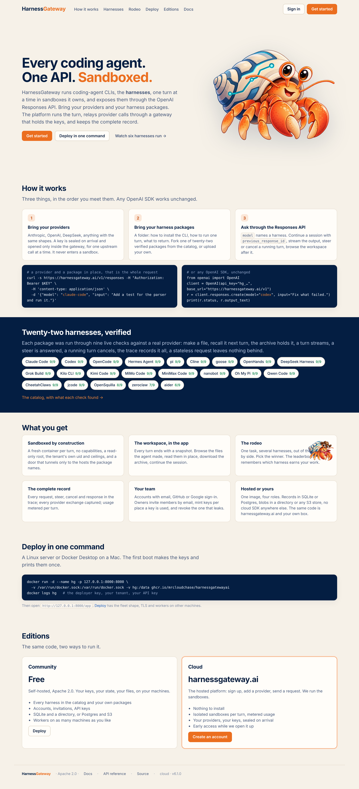
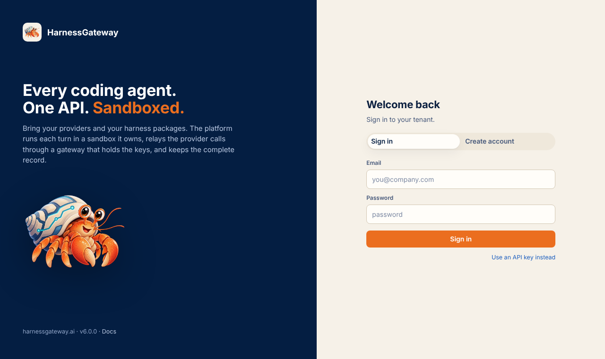
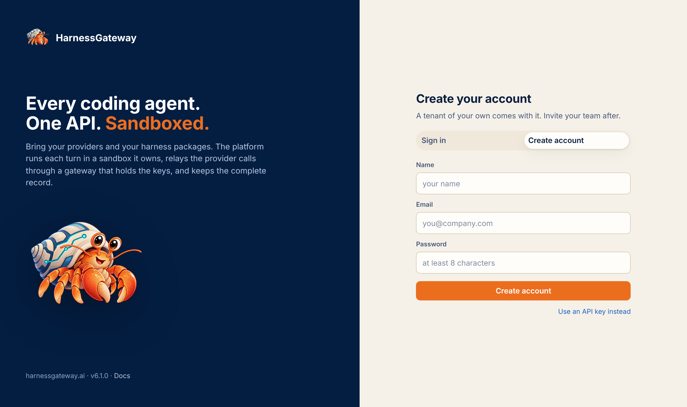

# The app

The platform serves three surfaces: the home page at `/`, this documentation at `/docs`, and the
app at `/app`. The app talks to the same routes every other client uses, so anything you do
there you can do with curl.

<figure class="shot" markdown>
{ loading=lazy }
<figcaption>The front door: what the platform is, the docs, the demos, and the way in.</figcaption>
</figure>

## Sign in

<figure class="shot" markdown>
{ loading=lazy }
<figcaption>A member's key opens their tenant; the deployer's key opens the platform dashboard.</figcaption>
</figure>

Paste the owner's key from the first boot's log, or from `init`. The key is kept in the browser's session storage only, so
closing the tab signs you out.

When sign-up is open, the app also offers to create a tenant. The owner's key is shown once,
with a button to continue as that owner. The home page's button leads straight to it.

<figure class="shot" markdown>
{ loading=lazy }
<figcaption>The hosted platform's front door: a tenant name and your member name.</figcaption>
</figure>

## The tabs

Signed in as a member or an owner, the app has five tabs, in the order you use them:

| Tab | What |
|---|---|
| Providers | the tenant's model endpoints; owners add and remove them |
| Harnesses | the tenant's packages, forked from the catalog or uploaded; owners add and remove them |
| Requests | a streamed request against a harness, with a steer field while it runs, and the response |
| Sessions | your sessions, or every member's when you are an owner; each opens to its turns, streams, trace and workspace |
| Members | the tenant's members (owners) and your API keys |

The ceilings a tenant runs under are the deployer's: cpus, memory and pids per run, timeouts,
runs at once, disk, output and upload sizes. `GET /v1/me` shows them; [Tenants and
limits](tenants.md) explains each. Signed in with the deployer key, the tabs are Dashboard,
Tenants and Workers; [Tenants and limits](tenants.md) and [Workers and scale](workers.md) show
them.

## The same from the API

```bash
curl -s https://hg.example.com/v1/me -H "Authorization: Bearer $KEY"
```

```json
{"tenant": "acme", "name": "chase", "role": "owner", "created": 1792713000.1,
 "limits": {"cpus": 2, "memory": "4g", "pids": 512, "run_timeout_s": 3600, "install_timeout_s": 1200,
            "max_runs": 4, "disk_mb": 2048, "output_mb": 16, "upload_mb": 64},
 "tenant_status": "active"}
```

Next: [Providers](providers.md).
