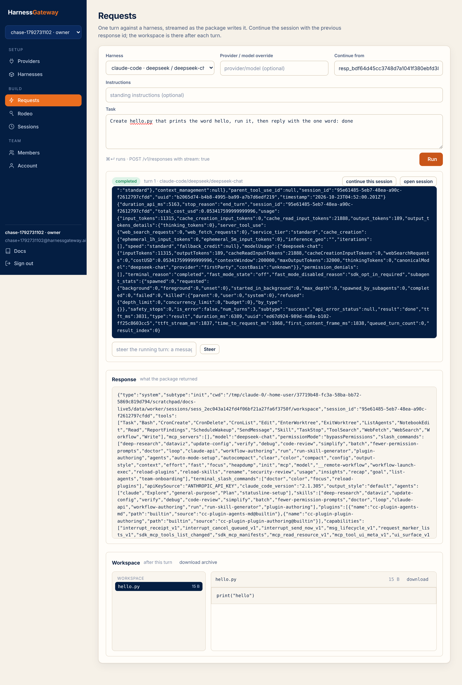

# The app

The platform serves three surfaces: the home page at `/`, this documentation at `/docs`, and the
app at `/app`. The app talks to the same routes every other client uses, so anything you do
there you can do with curl.

<figure class="shot" markdown>
{ loading=lazy }
<figcaption>The front door: what the platform is, the harnesses, the one-command deploy, the editions, the way in.</figcaption>
</figure>

## Sign in

<figure class="shot" markdown>
{ loading=lazy }
<figcaption>An account signs in with its email and password, with GitHub or Google when the platform offers them, or with an API key.</figcaption>
</figure>

An **account** is a person: an email, a name, a password or an identity provider, and the
tenants it belongs to. Sign in and the app opens the tenant you used last; switch tenants from
the sidebar. The session is a signed cookie that lasts a week; sign out ends it.

**Creating an account.** When sign-up is open (`HG_SIGNUP=open`, the hosted platform), anyone
can create one, and a tenant of their own, named after them, comes with it. When sign-up is
closed (a self-hosted box), accounts come by invitation: an owner invites an email from the
Members page, and that email can then create an account and lands in the tenant. With mail
configured (`HG_SMTP_URL`), a new account verifies its email first; without it, it is verified
at once.

**GitHub and Google.** Set `HG_GITHUB_CLIENT_ID` and `HG_GITHUB_CLIENT_SECRET`, or the Google
pair, and the buttons appear. An account that arrives from a provider with an email the platform
already knows is linked to that account. The callback URLs are `/auth/github/callback` and
`/auth/google/callback` under `HG_PUBLIC_URL`.

<figure class="shot" markdown>
{ loading=lazy }
<figcaption>Create an account; a tenant of your own comes with it when sign-up is open.</figcaption>
</figure>

**An API key instead.** The link under the form takes a member's `hg_…` key or the deployer's
`hgd_…` key, which is how the deployer signs in. The key is kept in the browser's session
storage only, so closing the tab signs you out.

## The pages

Signed in as a member or an owner, the sidebar has seven pages in three groups, in the order
you use them: Setup, then Build, then Team.

| Group | Page | What |
|---|---|---|
| Setup | Providers | the tenant's model endpoints; owners add and remove them |
| Setup | Harnesses | the tenant's packages, forked from the catalog or uploaded; owners add and remove them |
| Build | Requests | a streamed request against a harness, a steer and a cancel while it runs, the response, and the workspace's files after it |
| Build | Rodeo | one task for two to six harnesses, side by side as they stream; pick the winner; the leaderboard |
| Build | Sessions | your sessions, or every member's when you are an owner; each opens to its turns, streams, trace, workspace and archive |
| Team | Members | the tenant's members and invitations (owners), and your API keys |
| Team | Account | your name, your password, your tenants; create another tenant |

<figure class="shot" markdown>
{ loading=lazy }
<figcaption>After a turn, the workspace is right there: the files the agent made, each readable in place, the archive one click away.</figcaption>
</figure>

The ceilings a tenant runs under are the deployer's: cpus, memory and pids per run, timeouts,
runs at once, disk, output and upload sizes. `GET /v1/me` shows them; [Tenants and
limits](tenants.md) explains each. Signed in with the deployer key, the pages are Dashboard,
Tenants and Workers; [Tenants and limits](tenants.md) and [Workers and scale](workers.md) show
them.

## The same from the API

```bash
curl -s https://hg.example.com/v1/me -H "Authorization: Bearer $KEY"
```

```json
{"tenant": "acme", "name": "chase", "role": "owner", "created": 1792713000.1,
 "limits": {"cpus": 2, "memory": "4g", "pids": 512, "run_timeout_s": 3600, "install_timeout_s": 1200,
            "max_runs": 4, "disk_mb": 2048, "output_mb": 16, "upload_mb": 64},
 "tenant_status": "active"}
```

Every member route accepts the app's session cookie in place of the key, which is all the app
uses. The sign-in routes themselves are under `/auth`: [API](api.md) lists them.

Next: [Providers](providers.md).
