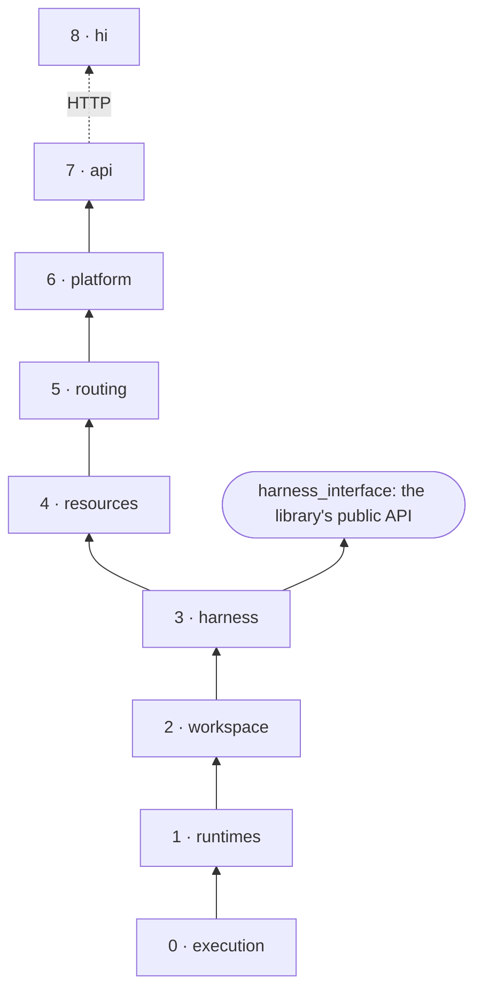

# Architecture

harness-interface is an execution layer. It runs a harness in a sandbox, gives it a workspace and
a session, streams what it prints, and records what it did. Everything about a particular harness,
such as its flags, where instructions go, how a session resumes and how its output becomes an
answer, lives in that harness's folder, not in this code.

## Layers

The code is a stack of layers. Each one imports only from the layers below it, so a change to one
layer can break only that layer and the layers above it.

| | Layer | Modules | Knows about |
|---|---|---|---|
| 0 | **Execution** | `errors.py`, `execution.py` | running something: a `Spec` in, `Event`s out, one `Outcome` |
| 1 | **Runtimes** | `runtimes/` | where it runs: a local process, or a hardened container behind the egress door |
| 2 | **Workspace** | `workspace.py` | a working directory as a git repository: snapshots, changes, diffs |
| 3 | **Harness** | `harness/` | the harness contract, and one `Turn` of a harness on any runtime |
| 4 | **Resources** | `resources/` | named providers, sandboxes and harnesses, stored as JSON |
| 5 | **Routing** | `routing.py` | which harness serves a request |
| 6 | **Platform** | `platform/` | turns in the background, records, conversations, cancelling, recovery |
| 7 | **Front ends** | `api/` | the OpenAI Responses API over HTTP |
| 8 | **Clients** | `frontend/cli/hi_cli/` | `hi`, which only calls the API |



Three rules hold the layers in place. [tests/test_layers.py](../../tests/test_layers.py) enforces
all three:
- **Imports point down.** A module may import from its own layer or any layer below it, never
  above.
- **The library is the standard library.** Layers 0 to 6 import nothing outside Python's standard
  library. FastAPI, pydantic and uvicorn appear only in `api/`, and come with the `[server]` extra.
- **`hi` only talks to the API.** The CLI never imports `harness_interface`; everything it does is
  an HTTP call, so any other client can do the same.

`harness_interface/__init__.py` is the library's front door: layers 0 to 3, and nothing from
`api/`. Layers 4 to 6 are importable by their full path, for building another server or front end.

## Every file, and what it is for

| File | Purpose | Change it when |
|---|---|---|
| `errors.py` | `Invalid`, `NotFound`, `Conflict`: the three ways a caller can ask wrong | never, without a new kind of refusal |
| `execution.py` | `Spec`, `Event`, `Outcome`, the `Execution` and `Runtime` protocols, `NeverStarted` | the meaning of "running something" changes. Rarely: every runtime implements it |
| `runtimes/process.py` | `ProcessExecution`: the only code that spawns a process, pumps its output, feeds input, times out and kills | process handling has a bug |
| `runtimes/local.py` | `LocalRuntime`: a process here, in the workspace | rarely |
| `runtimes/docker.py` | `Sandbox`, `Docker` (builds each image once), `DockerRuntime` (one hardened container per run, its network and door, teardown) | the sandbox's guarantees change |
| `runtimes/egress.py` | the egress door: a CONNECT-only allowlist proxy, run inside its own container | the door's rules change |
| `workspace.py` | `Workspace`: init, write, snapshot, changes, diff, files, read; internal paths hidden | what a change or a file means changes |
| `harness/template.py` | `{name}` placeholders, the one templating mechanism | rarely |
| `harness/contract.py` | `harness.json` (`Harness`, `Run`), `Provider`, `Request`, `Result`, and `prepare`/`collect`: what a harness is given and what is read back | the harness contract changes |
| `harness/turn.py` | `Turn`: prepare, start, stream, cancel, collect, snapshot | how a turn is sequenced changes |
| `resources/store.py` | `JsonStore`: one JSON file per item, written whole | storage changes |
| `resources/registry.py` | `Registry`: the three kinds, the built-in `default` sandbox, `resolve` | a resource kind is added or changes |
| `resources/default.Dockerfile` | the built-in sandbox: every shipped harness's CLI | a shipped harness needs a new tool or version |
| `routing.py` | `Route`, the `Router` protocol, `ByName` | how a request picks its harness changes |
| `platform/records.py` | `Record`: one turn, from start to end; `finish` and `fail` | the record gains or changes a field |
| `platform/runs.py` | `Run`: a turn in flight and its followers | rarely |
| `platform/placement.py` | where each run goes: `DockerPlacement`, `LocalPlacement` | a new place to run turns |
| `platform/service.py` | `Service`: start, get, list, cancel, recover; drives each turn to its record | how turns are owned or conversations work |
| `api/config.py` | `Settings`, from `HI_*` variables | a server setting is added |
| `api/wire.py` | the Responses format: a request to an `Ask`, a `Record` to a response, a run to SSE | the wire format changes |
| `api/app.py` | routes, error mapping, `build` and `main` | an endpoint is added or changes |
| `frontend/cli/hi_cli/api.py` | one method per endpoint | an endpoint is added or changes |
| `frontend/cli/hi_cli/main.py` | the commands, their flags and output | a command is added or changes |
| `frontend/cli/hi_cli/daemon.py` | `hi server start/stop/status/logs` | rarely |
| `frontend/cli/hi_cli/harness.py` | a harness folder as a PUT body; the shipped folders | rarely |
| `harnesses/*/` | one folder per shipped harness: configuration, not platform code | that harness's CLI changes |

Every module in the package opens with a docstring that names its layer and says what it is for
and what it promises. Read that first; it is kept true.

## The life of a turn

### From the library

```python
turn = await Turn.start(runtime, harness, provider, Request("Fix the test"), workspace, scripts)
```

1. **Prepare** (in a thread, since it is file and git work). `Workspace.init` makes the workspace a
   git repository if it isn't one. `prepare` writes the request's files, the harness's templated
   `files` and `.hi/request.json`, removes any stale `.hi/output.json`, and returns the `Spec`:
   the templated argv, `HI_*` variables and `run.env`, the request on stdin, the timeout. A
   snapshot of the workspace is the turn's `base`.
2. **Start.** `runtime.start(spec)` runs as a task, so `Turn.start` returns at once. On Docker it
   builds the sandbox's image if needed, hands the workspace to uid 1000 if the server runs as
   root, creates an internal network and the door, waits for the door, and spawns `docker run`.
3. **Stream.** `turn.events()` yields the execution's events. Output is pumped into a queue as it
   is written, whether or not anyone reads it.
4. **Cancel**, from any thread. While the runtime is still starting, the start is cancelled, its
   teardown runs, and the harness never starts. Once it is running, the process group or container
   is killed.
5. **Collect.** `turn.result()` waits for the `Outcome`, then `collect` reads `.hi/output.json`.
   A timeout or cancel decides the status first, then the status the harness reported, then its
   exit code. The changed and deleted files are read, and a second snapshot is the turn's
   `commit`.

### From the server

```
POST /responses ─► wire.ResponseRequest.ask() ─► Service.start(ask)
   ├─ the previous record, if it continues one: its workspace, session and harness
   ├─ Router.route(model, its harness)  ─► Registry.resolve(harness) ─► provider, sandbox, scripts
   ├─ a Record, status running; the conversation's workspace marked busy (else 409)
   ├─ Turn.start(Placement.runtime(resolved), …)
   └─ a background task, _drive: pump events to .out/.log files and to followers,
      then Record.finish(result), or fail("internal_error") on a bug; always free the workspace
◄─ the Record as a response, or wire.stream(run) as server-sent events
```

The turn belongs to the service, not to the request. A client that disconnects only stops
following; the turn runs on and is recorded. At startup, `Service.recover` fails every record
still `running` with `server_restarted`, and the placement removes the containers and networks
the last process left behind.

## Decisions, and why

- **A harness is configuration.** The contract is environment variables in, one optional JSON
  file out. No harness implements a protocol, so a CLI works the way it ships, and adding one
  never changes this code. The price is that the platform has no common event schema across
  harnesses: it streams their own output and records the same `Result` for all of them.
- **A failure to start is an outcome.** `runtime.start` returns an execution whose outcome is
  `failed(reason)` (`NeverStarted`) instead of raising, so callers handle one path. Only a
  caller's mistake raises, and as `Invalid`.
- **Output never waits on a reader.** Pumps read stdout and stderr into an unbounded queue, so a
  harness never blocks on a full pipe and `wait()` never depends on anyone iterating events.
- **The same paths inside and outside.** The workspace and the scripts are mounted at their own
  paths, so `{workspace}`, `{harness_dir}` and every path in a record mean the same thing to the
  harness, the server and the user.
- **One way out.** A sandbox's only network is internal; the egress door is the one container on
  it that is also on the bridge, and it tunnels only to allowed hosts. TLS stays end to end.
- **The platform never puts a key on a command line.** `docker run -e NAME` passes names only;
  values come from the environment of the `docker` process. The server never writes a key to a
  record, a log or an API response. What a harness does with its key inside its sandbox is up to
  the harness.
- **One turn per conversation.** A conversation is one workspace and one harness session; two
  turns at once in either would corrupt it, so a second gets 409.
- **Records are written twice.** Once when the turn starts (so it can be listed and followed) and
  once when it ends, whatever ended it.
