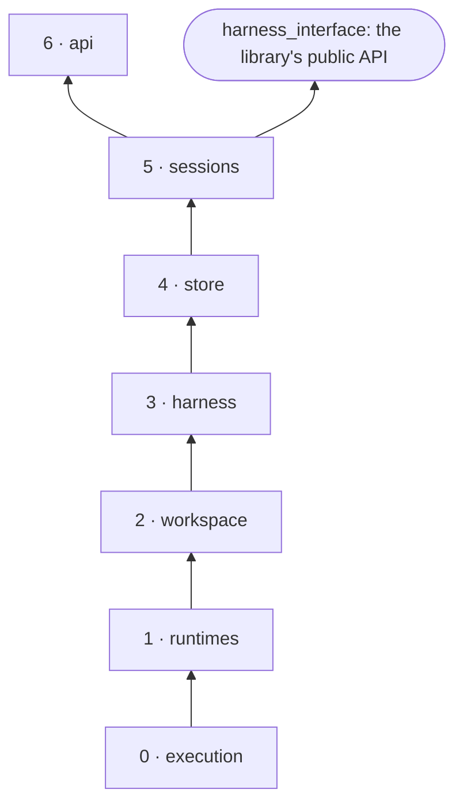

# Architecture

harness-interface is an execution layer. It installs a harness once, runs it in a sandbox with its
config and work artifacts in place, streams what it prints, takes interrupts and stops, and returns
everything it produced. Everything about a particular CLI (its flags, where its config goes, how it
resumes, steers and stops, how its output becomes an answer) lives in that harness's folder, not in
this code.

## Layers

Each layer imports only from the layers below it, so a change to one can break only it and the
layers above.

| | Layer | Modules | Knows about |
|---|---|---|---|
| 0 | **Execution** | `errors.py`, `execution.py` | running something: a `Spec` in, `Event`s out, input, a stop or a kill, one `Outcome` |
| 1 | **Runtimes** | `runtimes/` | where it runs: a process here, or a hardened container behind its door and gateway |
| 2 | **Workspace** | `workspace.py` | a working directory and its history: snapshots, changes, diffs, files |
| 3 | **Harness** | `harness/` | contract 1: a folder, its cached install, `prepare` and `collect`, one `Response` |
| 4 | **Store** | `store.py` | what is kept by name: providers, and harness folders with their install state |
| 5 | **Sessions** | `sessions.py` | sessions and responses in the background: follow, interrupt, stop, artifacts, recovery |
| 6 | **Server** | `api/` | the OpenAI Responses API and the session routes over HTTP |



[tests/test_layers.py](../../tests/test_layers.py) enforces three rules:
- **Imports point down.** A module imports from its own layer or below, never above.
- **The library is the standard library.** Layers 0 to 5 import nothing outside it. FastAPI, pydantic
  and uvicorn appear only in `api/`, with the `[server]` extra.
- **Every module says its layer first**, in its docstring.

`harness_interface/__init__.py` is the library's front door: layers 0 to 5, nothing from `api/`.

## Every file

| File | Purpose |
|---|---|
| `errors.py` | `Invalid`, `NotFound`, `Conflict`: the three ways a caller can ask wrong |
| `execution.py` | `Spec`, `Event`, `Outcome` (exited, timed_out, stopped, killed, failed), the `Execution` and `Runtime` protocols, `NeverStarted` |
| `runtimes/process.py` | the only code that spawns a process: pumps its output, feeds its input, stops, kills, times out; the allowlist of host variables a child may inherit |
| `runtimes/local.py` | `LocalRuntime`: a process here, with a loopback gateway or a key file for its provider |
| `runtimes/docker.py` | `DockerRuntime` (one hardened container per run, its network, door and credential, teardown, the owner's sweep) and `Images` (each Dockerfile built once) |
| `runtimes/door.py` | the egress door and provider gateway, a stdlib script run in its own container |
| `workspace.py` | `Workspace`: snapshots and their diffs, changes and files, with its git history kept outside it; internal paths hidden |
| `harness/folder.py` | `HarnessFolder.load`: contract 1's closed `harness.json` and required files; `check_provider_url` |
| `harness/hi_adapter.py` | the canonical adapter plumbing, copied byte-identical into every folder |
| `harness/base.Dockerfile` | the base image every harness runs in: bash, Python, Node and npm, uv, git, CA certificates; no CLI, no secret |
| `harness/install.py` | `Installer`: `install.sh` into a tools directory, once per version, locked, marker last |
| `harness/placement.py` | `Placement`: Docker or this machine, the images, the owner; gives each install and response its runtime |
| `harness/contract.py` | `prepare` (artifacts in, the `Spec`) and `collect` (HI_OUTPUT, changes, reported artifacts out): contract 1, written once |
| `harness/response.py` | `Response`: one response on any runtime; its events, `steer`, `stop`, `result` |
| `store.py` | `JsonStore`, `ProviderEntry`, `Registry` (providers, harness folders, installs in the background) |
| `sessions.py` | `Ask`, `Session`, `ResponseRecord`, `Sessions`: start, follow, wait, interrupt, stop, artifacts, recover |
| `api/wire.py` | the Responses format, and the only module that knows it: a request to an `Ask`, a record to a response object, events to SSE |
| `api/app.py` | the routes, and `main`, the server's entry point |
| `api/config.py` | the server's settings, from `HI_*` variables |

## The life of a response

```
POST /responses
  wire.ResponseRequest.ask()                 the Responses format, to an Ask
  Sessions.start(ask)
    parse_model                              harness[@provider][/model]
    previous response, if continuing         its session: harness, provider, workspace, resume; busy is a 409
    _choose_provider                         the one named, or the one for the folder's default URL and shape
    new Session or the same one, a ResponseRecord in_progress, the session active
  in the background, Sessions._one:
    Registry.ready(harness)                  waits for the install: Installer, once per version
    Response.start
      contract.prepare                       workspace/ on a new session; the request's files; home/ into .home;
                                             files rendered; a snapshot; the Spec: bash run.sh, line 1 on stdin
      Placement.runtime(image, mounts, egress, provider)
      runtime.start(spec)                    Docker: network, door (and gateway, the key on its stdin), credential,
                                             docker run --init, hardened, same paths inside and out
    Sessions._pump                           stdout, stderr, door and steers to logs/, and to followers
    Response.result → contract.collect       HI_OUTPUT, the status, changes, reported artifacts, a snapshot
    the record finished; undelivered steers sent again as the next response if it ended ok
  reply: the finished response, or SSE: response.created, harness.stdout/stderr per line, harness.steer,
         session.interrupted, response.completed
```

A response belongs to the server, not the request: a client that leaves only stops following. At
startup `Sessions.recover` fails every response still in progress with `server_restarted` (its resume
kept), marks every session idle, and sweeps this data directory's leftover containers, networks and
credentials.

## Interrupts and stops

`Sessions.interrupt(id, text)` degrades by what is running and the folder's `run.interrupt` tier:
- a `steered` response running: one JSON-string line on its stdin; the adapter hands it to the CLI. If
  the line can't be delivered, the next step applies.
- anything else running: the response is stopped (SIGINT, a kill after `stop_timeout_s`), and the
  session continues with the text in a new response, `continued` or `responded`.
- nothing running: the session continues with the text.

A stop is SIGINT to the process group (through tini under Docker), which `hi_adapter` turns into the
adapter's graceful `stop`; the end of stdin means the same. A response that ends while its status is
still `running` and had a resume is `stopped`, so it can be continued.

## Why it is built this way

- **Contract, not protocol.** A harness gets environment variables, stdin and a result file. Any CLI in
  any language fits behind a folder; the server never learns a CLI's flags or output.
- **Install once, run fresh.** The CLI is installed into a tools directory per version and mounted
  read-only; every response gets a new container from a small base image with no secrets.
- **The key stays out.** The gateway holds the key; the run holds a token valid only at its gateway.
- **Same paths inside and out.** The workspace, folder and tools mount at their own paths, so nothing
  above layer 1 translates a path, and npm and uv installs work where they were made.
- **History outside the workspace.** The server's git history of a workspace is kept beside it, so
  what runs inside can't plant hooks or rewrite what the server reports.
