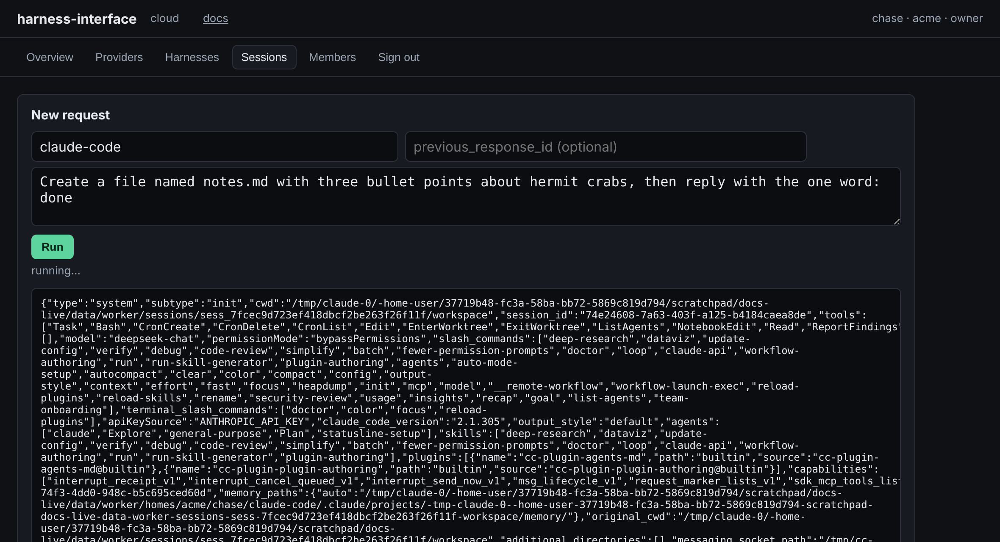
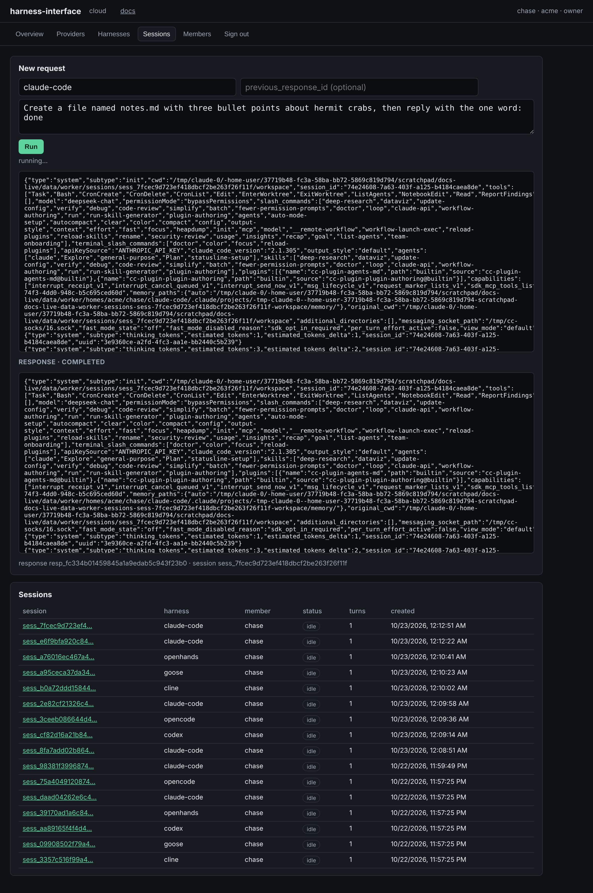

# First request

A provider and a harness in place, a request is one call.

```bash
curl -s https://hi.example.com/v1/responses -H "Authorization: Bearer $KEY" \
  -H 'content-type: application/json' \
  -d '{"model": "claude-code", "input": "Create hello.txt containing the word hello, then reply with the one word: done"}'
```

`model` is the harness name. The package's defaults choose the provider and the model; name all
three as `harness/provider/model` to choose otherwise: `claude-code/deepseek/deepseek-chat`.

The reply is a standard response object:

```json
{"id": "resp_…", "object": "response", "status": "completed", "model": "claude-code/deepseek/deepseek-chat",
 "output": [{"type": "message", "role": "assistant", "status": "completed",
             "content": [{"type": "output_text", "text": "…done", "annotations": []}]}],
 "metadata": {"session_id": "sess_…", "harness": "claude-code", "version": "3f0c…", "turn": "1", "exit_code": "0"},
 "previous_response_id": null, "store": true, "usage": null, …}
```

- `output[0]` is the one assistant message. Its text is exactly what the package returned: what
  `response.sh` printed, or `request.sh`'s stdout when the package has no `response.sh`. The
  platform does not reshape it.
- `status` is `completed` when the package exited 0, `failed` otherwise (with `error`),
  `incomplete` past the timeout, `cancelled` after a cancel.
- `metadata.session_id` is the session this turn opened. The next turn continues it with
  `previous_response_id`.
- `usage` is null: token counts belong to the provider calls the package made, and those are in
  the captures.

## From the console

<figure class="shot" markdown>
{ loading=lazy }
<figcaption>Run streams the package's stdout as it is written.</figcaption>
</figure>

<figure class="shot" markdown>
{ loading=lazy }
<figcaption>The response below the live output; the session appears in the list.</figcaption>
</figure>

## Stream it

```bash
curl -sN https://hi.example.com/v1/responses -H "Authorization: Bearer $KEY" \
  -H 'content-type: application/json' \
  -d '{"model": "claude-code", "input": "Explain this repository in three sentences.", "stream": true}'
```

The standard event sequence: `response.created`, `response.in_progress`, the output item and
content part added, then one `response.output_text.delta` per chunk of `request.sh`'s stdout as
it arrives, then the text done, the part done, the item done, and `response.completed` (or
`response.failed`, `response.incomplete`) with the whole response.

## Run it in the background

```bash
curl -s https://hi.example.com/v1/responses -H "Authorization: Bearer $KEY" -H 'content-type: application/json' \
  -d '{"model": "claude-code", "input": "Refactor the parser.", "background": true}'
curl -s https://hi.example.com/v1/responses/resp_… -H "Authorization: Bearer $KEY"
```

The first call returns at once with `status: in_progress`. Poll, or follow with `?stream=true`.

## Send files

Files in the input are written into the workspace before the turn starts:

```json
{"model": "claude-code",
 "input": [{"type": "message", "role": "user", "content": [
   {"type": "input_text", "text": "Fix the failing test in test_parse.py"},
   {"type": "input_file", "filename": "test_parse.py", "file_data": "data:text/x-python;base64,…"}]}]}
```

`filename` is a relative path inside the workspace. `file_data` is a data URL or plain text. The
trace records the names and sizes, not the bytes.

## Instructions

`instructions` reaches the package as `HI_INSTRUCTIONS`; the catalog's packages pass it to the
CLI as a system prompt where the CLI takes one.

## Keep nothing

`"store": false` runs the turn and keeps no workspace. The session cannot be continued and the
archive is empty, but the response and its trace remain.

Next: [Sessions](sessions.md).
