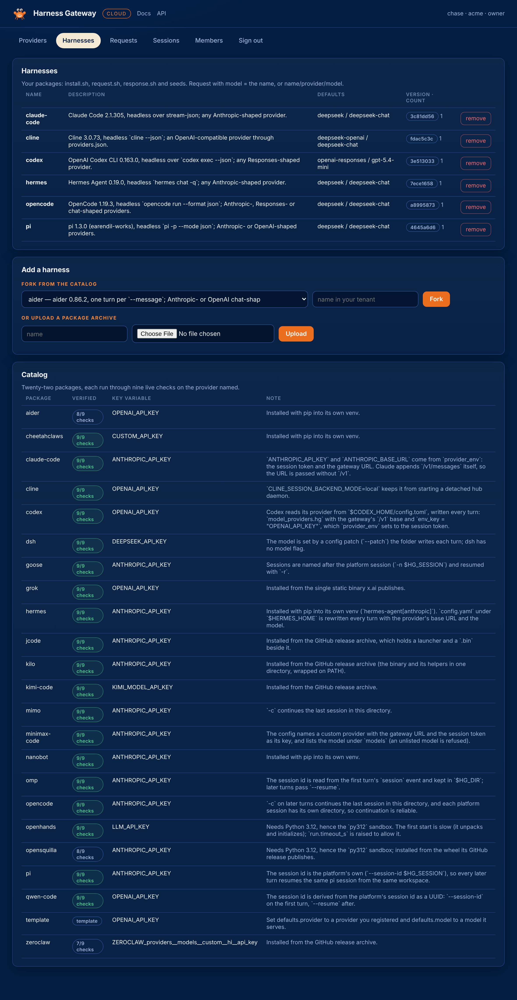

# Harnesses

A harness is a package the tenant owns: `harness.json`, `install.sh`, `request.sh`, an optional
`response.sh`, and seeds. The quickest way to one is forking a package from the catalog.

<figure class="shot" markdown>
{ loading=lazy }
<figcaption>Each catalog row shows how many of the nine live checks the package passed.</figcaption>
</figure>

## Fork from the catalog

```bash
curl -s https://hg.example.com/v1/catalog -H "Authorization: Bearer $KEY"
curl -s -X PUT https://hg.example.com/v1/harnesses/claude-code -H "Authorization: Bearer $KEY" \
  -H 'content-type: application/json' -d '{"catalog": "claude-code"}'
```

The fork is a copy. The tenant owns it from then on, and the platform never changes it. Name it
anything; `model` in a request is that name.

[The catalog](catalog/index.md) lists the twenty-two packages, their default providers and the
checks each passed.

## Upload your own

```bash
tar czf my-harness.tgz -C my-harness .
curl -s -X PUT https://hg.example.com/v1/harnesses/my-harness -H "Authorization: Bearer $KEY" \
  -H 'content-type: application/x-tar' --data-binary @my-harness.tgz
```

The platform unpacks the archive, validates it (the three required files, contract 5 in
`harness.json`, scripts that parse as bash, egress hosts that are not private), and keeps it as a
version named by the digest of its files. Uploading the same bytes twice is one version. A
session keeps the version it started on; re-upload an older folder to roll back.

What is refused, with the reason in the response: an archive over the tenant's upload limit, an
archive that reaches outside itself, a `harness.json` with unknown keys, a script with a syntax
error, a seeds directory with anything but `org`, `user` and `project`.

[Write a package](packages.md) is the contract.

## What you see afterwards

```bash
curl -s https://hg.example.com/v1/harnesses/claude-code -H "Authorization: Bearer $KEY"
```

```json
{"name": "claude-code", "version": "3f0c…", "created": 1792713100.4, "versions": ["3f0c…"],
 "contract": 5, "description": "Claude Code 2.1.305, headless over stream-json; any Anthropic-shaped provider.",
 "defaults": {"provider": "deepseek", "model": "deepseek-chat"},
 "provider_env": {"key": "ANTHROPIC_API_KEY", "url": "ANTHROPIC_BASE_URL"}, "interrupt": "SIGUSR1",
 "install": {"egress": ["registry.npmjs.org"], "timeout_s": 1200},
 "run": {"egress": [], "timeout_s": 1800, "stop_timeout_s": 20}}
```

The configuration and the versions, never the files. The platform does not serve packages back.

## The first run installs

A package's `install.sh` runs once per version on each worker, unprivileged, in the base image,
with egress to the hosts the package lists under `install`. For a Node CLI that is a minute or
two; for a Python one with a virtualenv, a few. The first request to a new package waits for it.
After that the tools layer is mounted read-only into every turn.

Next: [First request](first-request.md).
