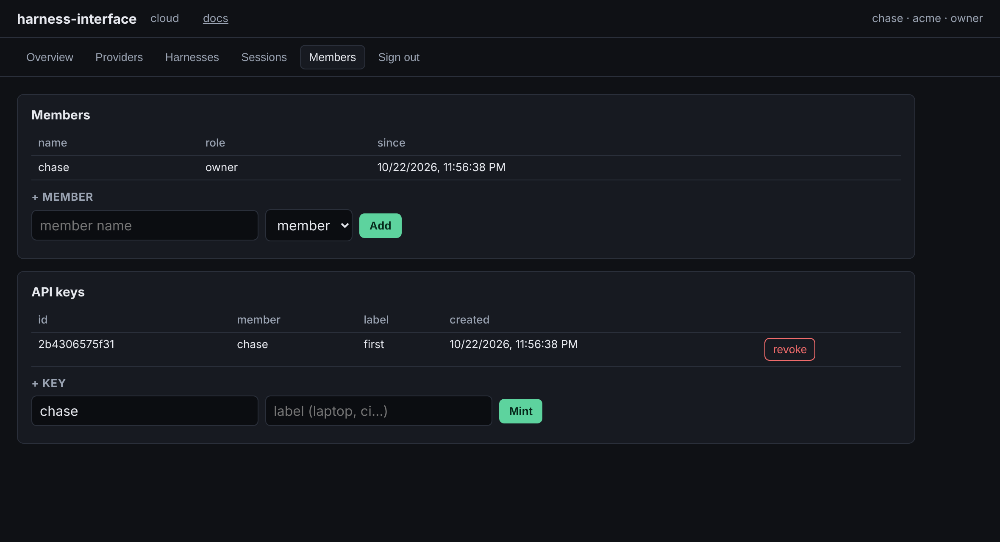

# Members and keys

A tenant has members. Owners register providers and packages and add members; every member makes
requests, sees their own sessions, and mints keys for themselves.

<figure class="shot" markdown>
{ loading=lazy }
<figcaption>A new key is shown once; revoke it here when it leaks.</figcaption>
</figure>

## Add a member

```bash
curl -s -X POST https://hi.example.com/v1/members -H "Authorization: Bearer $KEY" \
  -H 'content-type: application/json' -d '{"name": "dana", "role": "member"}'
```

Owner only. `role` is `member` or `owner`. Names are lowercase letters, digits, dots, dashes and
underscores, up to 63 characters, starting with a letter or digit, like every name on the
platform.

## Mint a key

```bash
curl -s -X POST https://hi.example.com/v1/members/dana/keys -H "Authorization: Bearer $KEY" \
  -H 'content-type: application/json' -d '{"label": "laptop"}'
```

```json
{"id": "a1b2c3d4e5f6", "tenant": "acme", "member": "dana", "label": "laptop", "created": 1792713300.2,
 "revoked": false, "secret": "hi_…"}
```

A member mints keys for themselves; an owner for anyone. The secret is shown once. The platform
keeps a hash, so a leaked key is revoked, never recovered. Mint one key per place a key lives,
labelled, so the one that leaks is the one you revoke.

## Revoke

```bash
curl -s -X DELETE https://hi.example.com/v1/keys/a1b2c3d4e5f6 -H "Authorization: Bearer $KEY"
```

Takes effect on the next request. A suspended tenant's keys all stop working until the deployer
reactivates it.

## Reach

| Who | Sees |
|---|---|
| a member | their own sessions, responses, traces and captures; the tenant's providers, harnesses and catalog |
| an owner | all of the above for every member of the tenant |
| the deployer | counts and sizes per tenant; never a session, a prompt, an output, a package or a key |

Nobody sees another tenant. A session id from another tenant is a 404.

Next: [Clients](clients.md).
