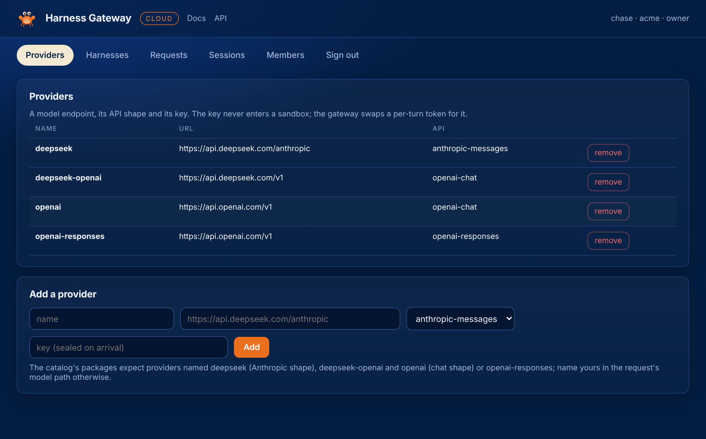

# Providers

A provider is a model endpoint, its API shape, and its key. The key is encrypted the moment it
arrives, bound to the provider's record so it cannot be moved, and decrypted only inside the
gateway for the one upstream call it signs. It never enters a sandbox, a worker, a log, a trace
or a capture.

<figure class="shot" markdown>
{ loading=lazy }
<figcaption>Name, URL and shape are shown; the key is never shown again.</figcaption>
</figure>

## Shapes

| `api` | What the CLI speaks | Typical `url` |
|---|---|---|
| `anthropic-messages` | Anthropic's Messages API | `https://api.anthropic.com`, `https://api.deepseek.com/anthropic` |
| `openai-chat` | OpenAI's Chat Completions | `https://api.openai.com/v1`, `https://api.deepseek.com/v1` |
| `openai-responses` | OpenAI's Responses API | `https://api.openai.com/v1` |
| `none` | an endpoint of your own that adds its own credential | anything public over HTTPS; `key` empty |

The shape decides which paths the gateway relays. An Anthropic-shaped provider gets `/v1/messages`
and `/v1/models`; the two OpenAI shapes share `/v1/chat/completions`, `/v1/responses`,
`/v1/embeddings` and `/v1/models`, since a CLI may use either endpoint against the same host.
Anything else is refused with a 403, so a chat key cannot be used for files, fine-tuning or
billing calls from inside a sandbox.

The URL's path matters. A CLI builds `base_url + /v1/messages`; the gateway's URL inside the
sandbox carries the same path as yours, so the CLI's idioms hold whatever the provider mounts its
API at.

## Add one

```bash
curl -s -X PUT https://hg.example.com/v1/providers/deepseek -H "Authorization: Bearer $KEY" \
  -H 'content-type: application/json' \
  -d "{\"url\": \"https://api.deepseek.com/anthropic\", \"api\": \"anthropic-messages\", \"key\": \"$DEEPSEEK_API_KEY\"}"
```

Only an owner can. The URL must be `https://` and must not name a private, loopback or
link-local address, unless the deployer allowed private egress for a self-hosted box. The key is
one line.

## Which names

The catalog's packages name a default provider each: `deepseek` (Anthropic shape),
`deepseek-openai` and `openai` (chat shape) or `openai-responses`. Register providers under those
names and the packages work as shipped, or name yours in the request's model path:
`claude-code/my-anthropic/claude-sonnet-4-5`.

A provider is one shape at one URL. The same endpoint under two shapes is two providers, which is
why `deepseek` and `deepseek-openai` both exist.

## Remove one

`DELETE /v1/providers/{name}`, owner only. Sessions already running keep their turn's token until
it ends; a later turn naming the provider is refused.

Next: [Harnesses](harnesses.md).
