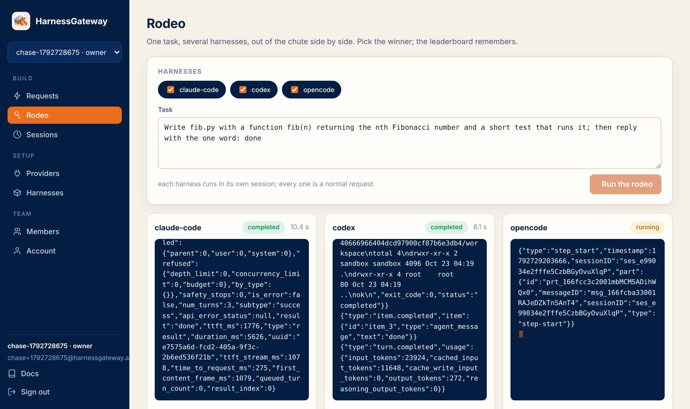
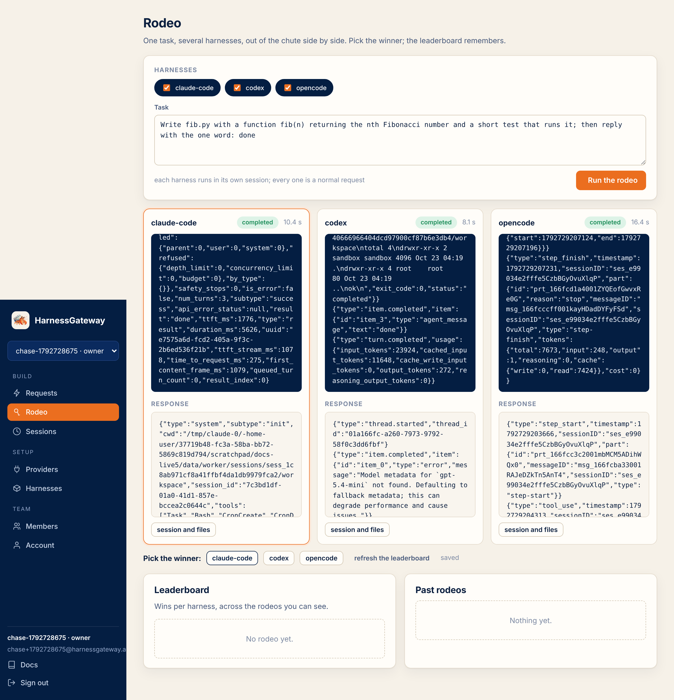
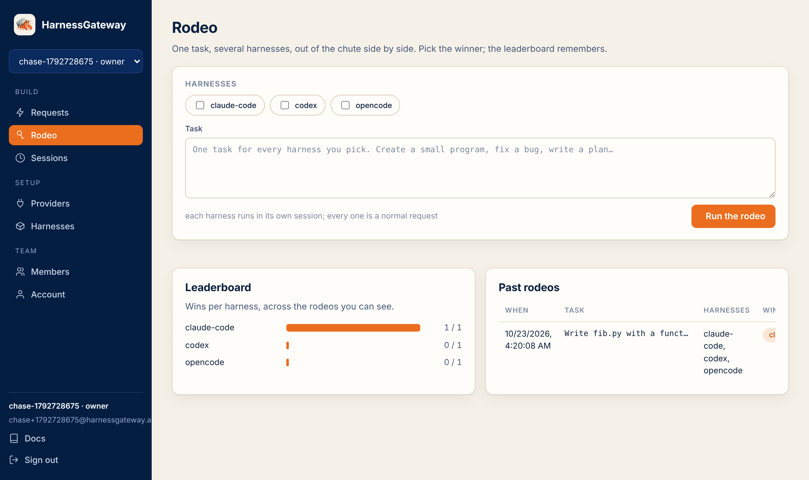

# Rodeo

One task, several harnesses, out of the chute side by side. Each entry is an ordinary request in a
session of its own; the rodeo records which harnesses ran the task and which one you picked.

<figure class="shot" markdown>
{ loading=lazy }
<figcaption>Pick two to six of your harnesses, give them one task, watch them stream.</figcaption>
</figure>

<figure class="shot" markdown>
{ loading=lazy }
<figcaption>Each column ends with its response and a link to its session and files. Pick the winner.</figcaption>
</figure>

## What it compares

What you can see: the output as it streams, how long each took, what each returned, and what
each left in its workspace. The platform scores nothing; the verdict is yours, and the
leaderboard is the sum of your verdicts.

<figure class="shot" markdown>
{ loading=lazy }
<figcaption>Wins per harness across the rodeos you can see; owners see the tenant's, members their own.</figcaption>
</figure>

## From the API

A rodeo is a record over responses you already made. Run the turns however you like, then:

```bash
curl -s https://hg.example.com/v1/rodeos -H "Authorization: Bearer $KEY" -H 'content-type: application/json' \
  -d '{"prompt": "write fib.py", "entries": [{"response": "resp_a"}, {"response": "resp_b"}]}'
curl -s -X PATCH https://hg.example.com/v1/rodeos/rodeo_… -H "Authorization: Bearer $KEY" -H 'content-type: application/json' \
  -d '{"winner": "codex"}'
curl -s https://hg.example.com/v1/rodeos -H "Authorization: Bearer $KEY"
```

The entries must be different harnesses, two to six of them, and responses you can reach. The
list carries a `leaderboard`: runs and wins per harness. `DELETE /v1/rodeos/{id}` removes the
record; the sessions stay. The 6.0 paths under `/v1/arenas` answer the same way.

Next: [Sessions](sessions.md).
