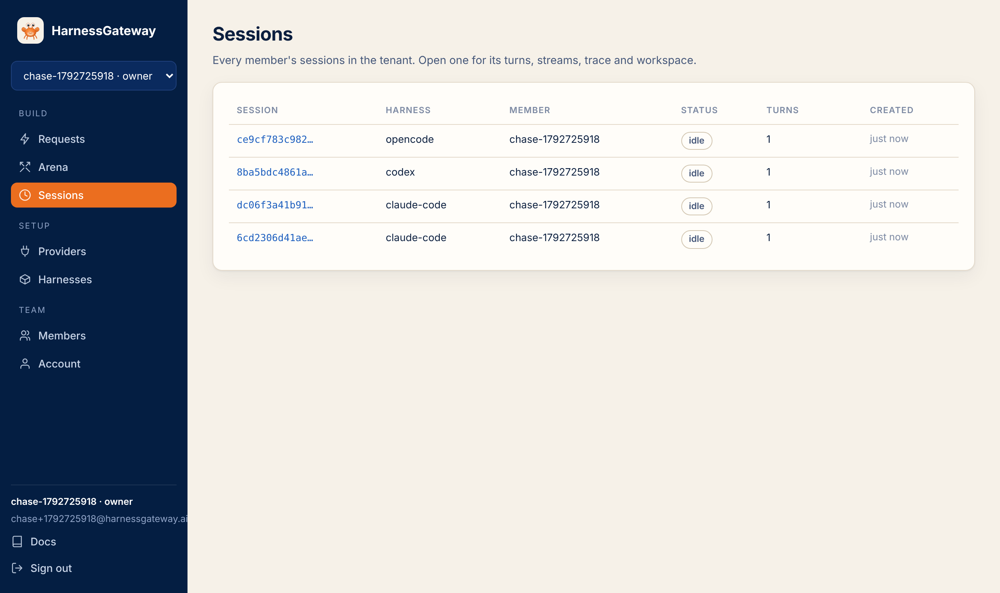
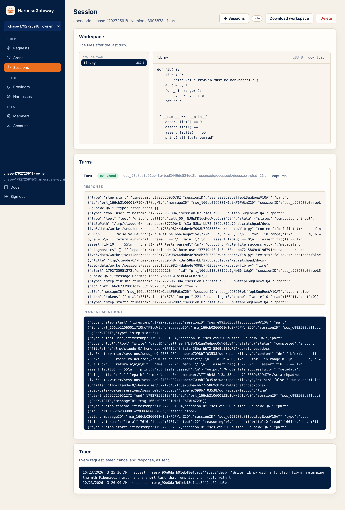

# Sessions

A session is a chain of turns that share a workspace and the CLI's own conversation. The first
request opens one; each later request names the previous response to continue it.

```bash
curl -s https://hg.example.com/v1/responses -H "Authorization: Bearer $KEY" -H 'content-type: application/json' \
  -d '{"model": "claude-code", "input": "Now add a test for it.", "previous_response_id": "resp_…"}'
```

The continuation runs on the same harness, the same package version and the same provider as the
session, with the workspace exactly as the last turn left it. The package's `request.sh` sees
`HG_TURN` as 2, 3, and so on, and resumes the CLI's conversation the way that CLI does it: the
catalog's packages pass `--continue`, `resume <thread>` or a session file as appropriate.

One turn at a time: a request against a session that is running a response is refused with 409.
Wait for it, cancel it, or steer it.

## What is kept

| Between turns of a session | Where |
|---|---|
| the workspace: every file the agent made or changed | a snapshot after each turn, restored on any worker |
| the member's home for that package: the CLI's config and conversation files | a snapshot per member and package, shared across their sessions |
| the run directory: files the package keeps for itself, such as a thread id | inside the session's tree on the worker; packages that need it durable keep it in the workspace or home |

A session is **stored** by default. A request with `"store": false` keeps no workspace; its
session can be read but not continued.

## The session page

<figure class="shot" markdown>
{ loading=lazy }
<figcaption>Owners see the whole tenant; members see their own.</figcaption>
</figure>

<figure class="shot" markdown>
{ loading=lazy }
<figcaption>The workspace's files first, then every turn's response and raw stdout, then the trace.</figcaption>
</figure>

## Read

```bash
curl -s https://hg.example.com/v1/sessions -H "Authorization: Bearer $KEY"
curl -s https://hg.example.com/v1/sessions/sess_… -H "Authorization: Bearer $KEY"
```

```json
{"id": "sess_…", "object": "session", "harness": "claude-code", "version": "3f0c…", "member": "chase",
 "created_at": 1792713200, "stored": true, "status": "idle", "responses": ["resp_…", "resp_…"]}
```

Members see their own sessions; owners see the tenant's. A session of another tenant does not
exist, as far as the API is concerned: every miss is a 404.

## The raw streams

```bash
curl -s "https://hg.example.com/v1/responses/resp_…?detail=true" -H "Authorization: Bearer $KEY"
```

Adds `stdout` and `stderr`, `request.sh`'s streams as kept, plus the worker that ran it and the
start and end times. While the turn runs, the streams hold what has arrived so far.

## The workspace's files

```bash
curl -s https://hg.example.com/v1/sessions/sess_…/files -H "Authorization: Bearer $KEY"
curl -s https://hg.example.com/v1/sessions/sess_…/files/src/app.py -H "Authorization: Bearer $KEY"
```

```json
{"object": "list", "data": [{"path": "README.md", "size": 412}, {"path": "src/app.py", "size": 1880}]}
```

Every file in the workspace after the last turn, with its size, and any one of them, from the
snapshot. A file over 4 MB is refused with 400; the archive has it. The app's Requests and
Sessions pages draw this as a tree with a viewer.

## The archive

```bash
curl -s https://hg.example.com/v1/sessions/sess_…/archive -H "Authorization: Bearer $KEY" -o workspace.tgz
```

The workspace after the last turn, as a gzipped tar. The home and the package are not in it.

## Delete

`DELETE /v1/sessions/{id}` removes the session, its responses, chunks, traces and blobs. It is
refused while a turn runs.

Next: [Steer and cancel](steer-and-cancel.md).
