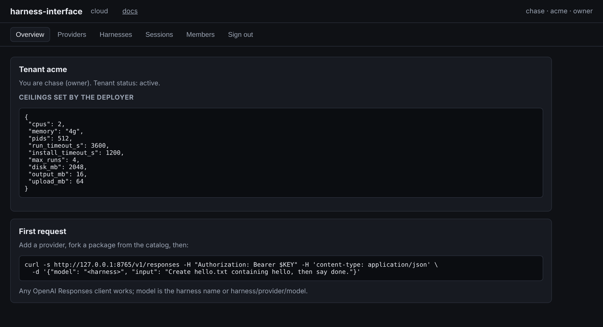

# Sign in

The console is a single page at the platform's root. It talks to the same routes every other
client uses, so anything you do here you can do with curl.

<figure class="shot" markdown>
{ loading=lazy }
<figcaption>A member's key opens their tenant; the deployer's key opens the fleet.</figcaption>
</figure>

Paste the owner's key from `init`. The key is kept in the browser's session storage only, so
closing the tab signs you out.

When sign-up is open, the page also offers to create a tenant. The owner's key is shown once,
with a button to continue as that owner.

<figure class="shot" markdown>
{ loading=lazy }
<figcaption>The hosted platform's front door: a tenant name and your member name.</figcaption>
</figure>

## The overview

<figure class="shot" markdown>
{ loading=lazy }
<figcaption>Who you are, the ceilings the deployer set, and a request ready to paste.</figcaption>
</figure>

The ceilings are the deployer's: cpus, memory and pids per run, timeouts, runs at once, disk,
output and upload sizes. A tenant cannot change them. [Tenants and limits](tenants.md) explains
each.

## The same from the API

```bash
curl -s https://hi.example.com/v1/me -H "Authorization: Bearer $KEY"
```

```json
{"tenant": "acme", "name": "chase", "role": "owner", "created": 1792713000.1,
 "limits": {"cpus": 2, "memory": "4g", "pids": 512, "run_timeout_s": 3600, "install_timeout_s": 1200,
            "max_runs": 4, "disk_mb": 2048, "output_mb": 16, "upload_mb": 64},
 "tenant_status": "active"}
```

Next: [Providers](providers.md).
