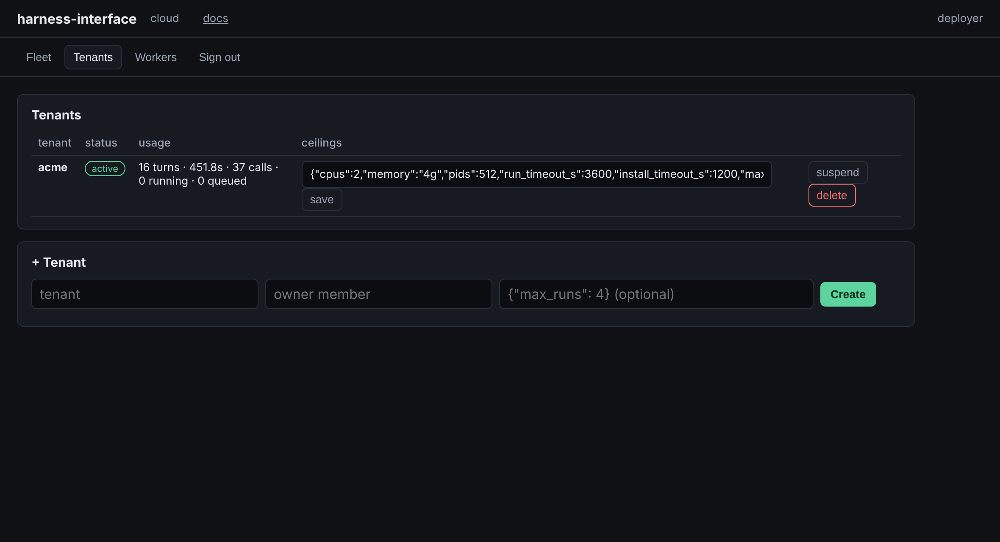

# Tenants and limits

The deployer creates tenants and sets what each may use. A tenant configures providers and
packages and nothing else: not the image its turns run in, not the limits they run under.

<figure class="shot" markdown>
{ loading=lazy }
<figcaption>Usage is counts and sizes. The deployer never sees a tenant's work.</figcaption>
</figure>

## Create

```bash
curl -s -X POST https://hi.example.com/v1/tenants -H "Authorization: Bearer $HD_KEY" \
  -H 'content-type: application/json' \
  -d '{"name": "acme", "owner": "chase", "limits": {"max_runs": 8, "cpus": 4}}'
```

The reply carries the first owner's key once. Limits not named take the defaults.

## The ceilings

| Limit | Default | Applies to |
|---|---|---|
| `cpus` | 2 | each sandbox |
| `memory` | `4g` | each sandbox, a Docker size |
| `pids` | 512 | each sandbox |
| `run_timeout_s` | 3600 | the most a package may ask for a turn |
| `install_timeout_s` | 1200 | the most a package may ask for its install |
| `max_runs` | 4 | turns at once across the tenant; more wait in the queue |
| `disk_mb` | 2048 | a session's workspace or home snapshot; a larger one fails the turn |
| `output_mb` | 16 | of a turn's output, stdout and stderr kept in its record; more is truncated |
| `upload_mb` | 64 | a package archive or a request's files |

A package asks for a timeout and gets at most the ceiling. Everything else is applied as is.

## Change

```bash
curl -s -X PATCH https://hi.example.com/v1/tenants/acme -H "Authorization: Bearer $HD_KEY" \
  -H 'content-type: application/json' -d '{"limits": {"max_runs": 2}}'
curl -s -X PATCH https://hi.example.com/v1/tenants/acme -H "Authorization: Bearer $HD_KEY" \
  -H 'content-type: application/json' -d '{"status": "suspended"}'
```

New limits apply to turns claimed from then on. A suspended tenant's keys stop working, its
queued turns stay queued, and its running turns finish. `active` brings it back.

## Read

```bash
curl -s https://hi.example.com/v1/tenants -H "Authorization: Bearer $HD_KEY"
curl -s https://hi.example.com/v1/tenants/acme -H "Authorization: Bearer $HD_KEY"
```

Per tenant: its limits and status, its members, the names of its providers and harnesses, and its
usage: turns, seconds, provider calls, bytes in and out, running and queued. No prompt, output,
package or key is reachable with the deployer key, and the member routes refuse it.

## Delete

`DELETE /v1/tenants/{name}` removes the tenant and everything it owns: members, keys, providers,
packages, sessions, responses, traces, captures and blobs. There is no undo.

Next: [Workers and scale](workers.md).
