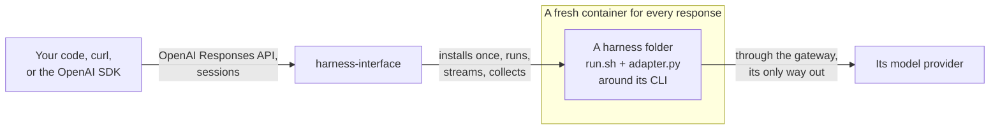

# How it works

harness-interface is an execution layer for coding harnesses. You send it a request; it runs the
harness the request names in a sandbox, streams back everything the harness prints, and returns
everything it produced. It doesn't speak any harness's protocol: each harness's folder does.

## Who owns what

- **The server owns execution:** the sandbox, the install cache, the session's workspace, copying the
  folder's artifacts in, the provider and its key, streaming, steering and stopping, and returning
  every output.
- **A harness folder owns everything about its CLI:** how to install it, which config and work
  artifacts it brings and where they go, how to run it, how to steer and stop it, and how to read its
  answer, resume handle and usage. The server has no code for any harness.

## The words

| | |
|---|---|
| **Harness** | a coding CLI, such as Claude Code or Codex, wrapped in a [folder](harnesses.md) |
| **Provider** | where a harness's model calls go, and the key for them ([providers](providers.md)) |
| **Session** | one harness and provider, one workspace, the CLI's own conversation, and every response in it, one at a time |
| **Response** | one request to a session, and everything it produced |
| **Workspace** | the session's directory: the work, with the CLI's `$HOME` in `.home/`. Every response's changes can be read back. |
| **Config artifacts** | what configures the CLI (instructions, skills, MCP, hooks, settings): the folder's `home/` and `files` |
| **Work artifacts** | what the CLI works on: the folder's `workspace/`, and the files a request sends |
| **Interrupt** | more text for a running session: steered into the work, or the start of the next response |

## One response

1. **Install, once.** The folder's `install.sh` puts its pinned CLI in a tools directory, keyed by a
   hash of the install script, the image and the CPU. Every later response reuses it.
2. **Prepare.** A new session copies the folder's `workspace/` in. Every response writes the request's
   files into the workspace, copies `home/` into `.home/`, and renders `files` (the request's
   `instructions` go wherever the CLI reads them).
3. **Run.** A fresh, locked-down container mounts the workspace and the tools at their own paths and
   runs `run.sh`, with the request on stdin and the provider as a gateway URL and a token file.
4. **Stream.** Every line the CLI prints is a `harness.stdout` or `harness.stderr` event, as it comes.
   An interrupt is one more line on stdin, which the folder's adapter hands to the CLI; a stop is
   SIGINT, then a kill.
5. **Collect.** The adapter's result file (`HI_OUTPUT`) gives the answer, status, resume handle, usage
   and cost. The server adds the workspace's diff and changed files, and any files the folder
   `report`s from `$HOME`, and returns all of it with the harness's raw output.

A continued session runs the same way, in the same workspace and `.home/`, and the CLI resumes its own
conversation. A new session is a clean workspace: it never sees another session's work.

## No shared protocol

Clients use the OpenAI Responses API they already know. Inside, the contract between the server and a
folder is environment variables, stdin and one JSON file ([the harness contract](harness-contract.md)).
A CLI works the way it ships; its folder adapts it, and adding one never changes the server.

The trade-off: the server doesn't translate harnesses into a common event vocabulary. Every response
has the same fields (answer, usage, cost, changes, diff, reported artifacts) beside the harness's own
output, byte for byte.

## Two ways in

| | For |
|---|---|
| [the server](api-clients.md), an OpenAI Responses-compatible API with session routes | any language, the OpenAI SDK, many clients at once |
| [the library](library.md) | Python that runs harnesses itself, with no server |

The server is built on the library, so both run a harness the same way.

## When it fits

A good fit for:
- running coding CLIs from your own code, agents or loops, sandboxed, on a machine you control;
- one configuration of a CLI, as a folder, run the same way by anyone who calls it;
- running the same task on several harnesses or providers.

Not a fit, today, for:
- a service for many users: there is no authentication or tenancy;
- fast, high-volume calls: every response starts a container, which costs a second or two.
