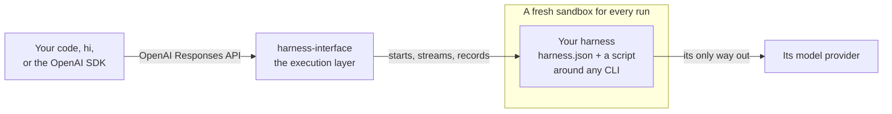

# How it works

harness-interface is an execution layer for coding harnesses. You send it a request; it runs the
harness the request names, in a sandbox, and keeps a record of what happened.

## Who owns what

- **The server owns the run:** the sandbox, the conversation's workspace and session, streaming,
  cancelling, timeouts, and the record of what happened.
- **A harness owns everything about its CLI.** It is a folder: a `harness.json`, and a script
  that turns the request into the CLI's own flags. It decides where instructions go, how a
  session resumes, which API the CLI speaks, and how its output becomes an answer.

## The words

| | |
|---|---|
| **Harness** | a program that does coding work, such as Claude Code or Codex, wrapped in a folder ([harnesses](harnesses.md)) |
| **Provider** | where a harness's model calls go, and the key for them ([providers](providers.md)) |
| **Sandbox** | the Dockerfile a harness runs in, and any extra hosts it may reach ([sandboxes](sandboxes.md)) |
| **Response** | one turn: a request to a harness, and its record |
| **Conversation** | turns chained with `previous_response_id`, sharing one workspace and the harness's session |
| **Workspace** | the conversation's directory, a git repository; every turn's changes can be read back |

## No new harness protocol

Clients use the OpenAI Responses API they already know. Inside, a harness is any program that
reads a few environment variables (`HI_TASK`, `HI_PROVIDER_KEY` and the rest) and may write one
JSON file back. That is the whole [harness contract](harness-contract.md). No harness has to
implement a shared protocol, so a CLI works the way it ships, and adding one never changes the
server.

The trade-off: the server doesn't translate harnesses into a common vocabulary. Every run gets
the same record (the answer, usage, cost, the files it changed and their diff) beside the
harness's own output, byte for byte. There is no shared event schema, and no capability
discovery across harnesses.

## Three ways in

| | For |
|---|---|
| [`hi`](cli.md), the command line | running harnesses from a terminal |
| [the server](api-clients.md), an OpenAI Responses-compatible API | any language, the OpenAI SDK, many clients at once |
| [the library](library.md) | Python that runs harnesses itself, with no server |

The server and `hi` are built on the library, so all three run a harness the same way.

## When to use it

A good fit for:
- running harnesses from your own code or loops, on a machine you control;
- wrapping your own CLI, or one nobody else supports, without changing the server;
- running the same task on several harnesses, each sandboxed and recorded.

Not a fit, today, for:
- a hosted service for many users: there is no authentication or tenancy;
- fast, high-volume decisions such as classifying or routing: every run starts a container and
  a workspace, which costs seconds, not milliseconds.
