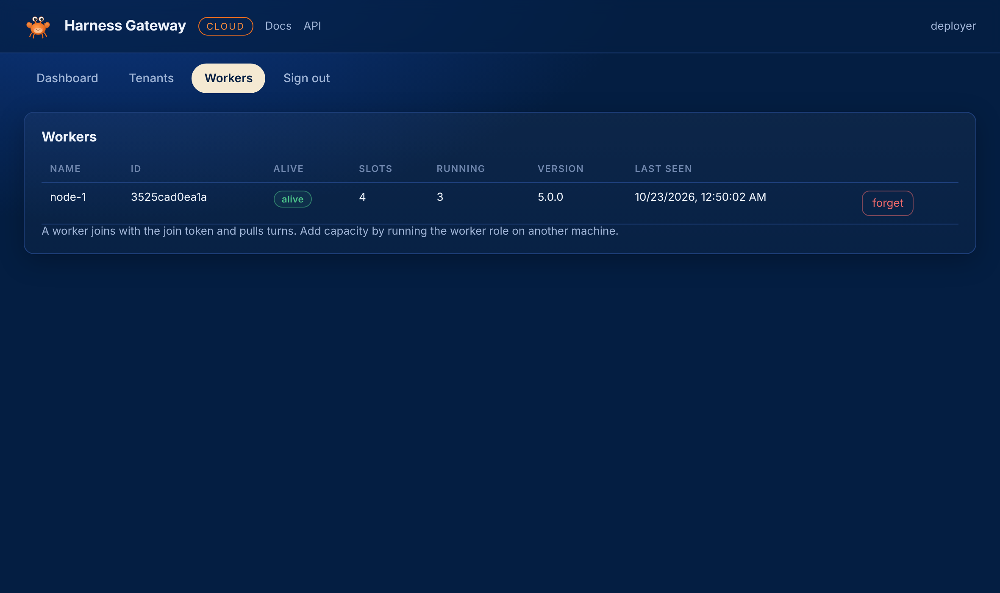
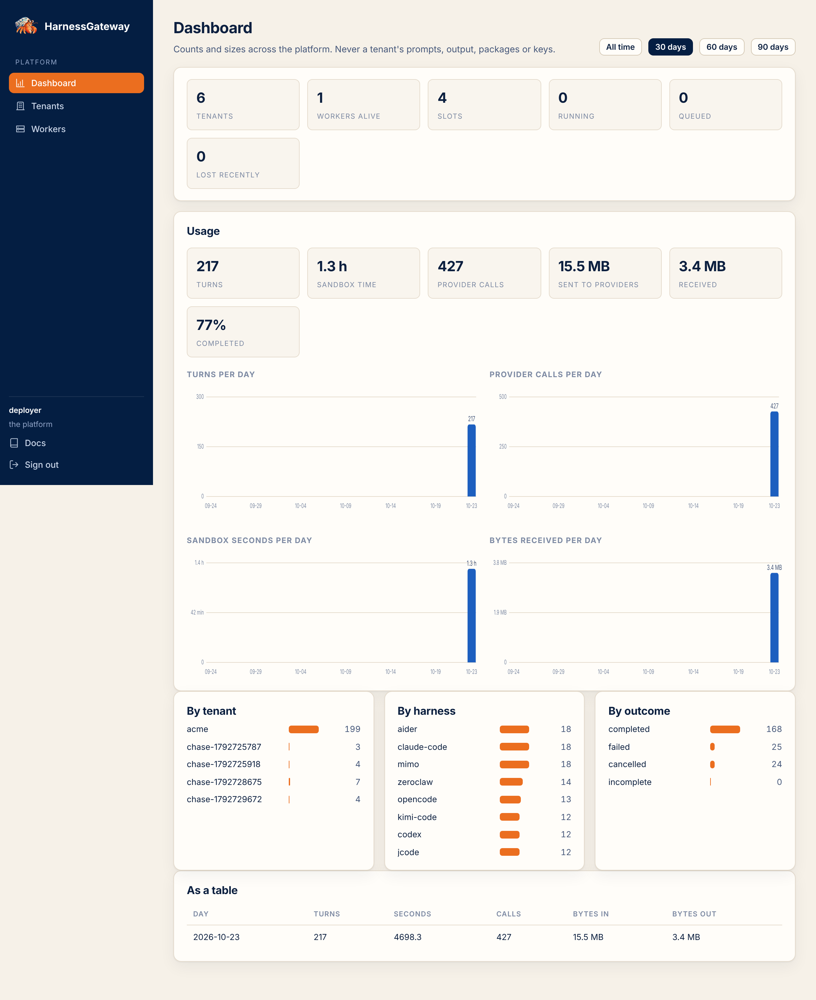

# Workers and scale

A worker is a machine with Docker that runs turns. It joins the control plane with a token, then
pulls: claim a turn, fetch what it needs through short-lived URLs, run the turn, stream the
output back, push the snapshots, report. It holds a worker credential and a cache, and nothing
else: no database, no bucket, no key.

<figure class="shot" markdown>
{ loading=lazy }
<figcaption>A worker is alive while it heartbeats; forget one that is gone.</figcaption>
</figure>

## Capacity

Each worker has `HG_WORKER_SLOTS` (default 4): turns it runs at once. The fleet's capacity is the
sum over live workers. A tenant's `max_runs` caps its share. A turn waits in the queue until a
worker with a free slot claims it; claims go to the oldest queued turn whose tenant is under its
cap.

A worker on a machine with eight cores and 32 GB of memory runs eight turns at the default
ceilings comfortably. Set the slots to what the machine has, not more.

## Add a worker

```bash
docker run -d --name hg-worker --restart unless-stopped \
  -v /var/run/docker.sock:/var/run/docker.sock -v /srv/hg/data:/srv/hg/data \
  --add-host host.docker.internal:host-gateway \
  -e HG_DATA_DIR=/srv/hg/data -e HG_CONTROL_URL=https://hg.example.com -e HG_JOIN_TOKEN=… \
  -e HG_GATEWAY_URL=https://gateway.hg.example.com -e HG_RUNTIME=runsc -e HG_WORKER_SLOTS=8 \
  ghcr.io/mrcloudchase/harnessgatewayai:5.0.1 serve --role worker
```

| Variable | What |
|---|---|
| `HG_CONTROL_URL` | the API, as this machine reaches it |
| `HG_JOIN_TOKEN` | the same value the control plane has as `HG_JOIN_TOKEN` |
| `HG_GATEWAY_URL` | the gateway, as this machine's sandboxes reach it: a TLS address behind your load balancer |
| `HG_BASE_IMAGE` | the sandbox image; empty builds the shipped one on this machine at first start |
| `HG_RUNTIME` | `runsc` to run every sandbox under gVisor; strongly recommended for strangers' tenants |
| `HG_DATA_DIR` | the cache, mounted at the same path inside and out |

The worker joins once and saves its credential under the data directory; the join token is not
needed again. `deploy/worker.cloud-init.yml` does all of this on a fresh machine.

## What a worker keeps

```
<data>/worker/
  worker.json                     its credential
  packages/<digest>/              packages, unpacked once
  tools/<digest>-<image>/         tools layers: install.sh's result, once per package version and base image
  sessions/<sid>/{workspace,run}  a session's trees between turns, restored from the snapshot when stale
  homes/<tenant>/<member>/<harness>/   a member's home for a package
```

Caches are rebuilt from blobs when missing. Deleting the directory costs a package install and a
snapshot download, nothing more.

## Failure

A worker heartbeats every five seconds. One that falls silent for forty-five seconds is lost:
the control plane fails its turns in flight with the reason, and their sessions continue on any
other worker from their last snapshot. A worker that comes back rejoins with its saved
credential and starts claiming again. The dashboard counts lost turns.

Stopping a worker is stopping the process. Its running turns are reported killed; nothing else
is affected. Remove its row with the forget button or `DELETE /v1/workers/{id}`.

## The dashboard

<figure class="shot" markdown>
{ loading=lazy }
<figcaption>Counts and sizes only, across the platform, all time or over the last 30, 60 or 90 days.</figcaption>
</figure>

The dashboard reads `GET /v1/fleet` and `GET /v1/usage?days=N` (`0` for all time). Usage is
turns, sandbox seconds, provider calls and bytes, from the usage record each turn leaves: per
day, per tenant, per harness, and by outcome. The same numbers are in a table below the charts.

## The base image

Every turn starts from one image: Debian, Python 3.12, Node 22, git, curl, ripgrep, procps,
tmux. Nothing of the platform and nothing of any package is in it; packages install their CLI
into a tools layer at first use. With `HG_BASE_IMAGE` empty each worker builds the shipped
Dockerfile once. For a fleet, build it once and publish it: the repository's base-image workflow
builds it on a schedule, scans it, and pushes it, and each worker then pulls the same image.

Next: [Configuration](configuration.md).
